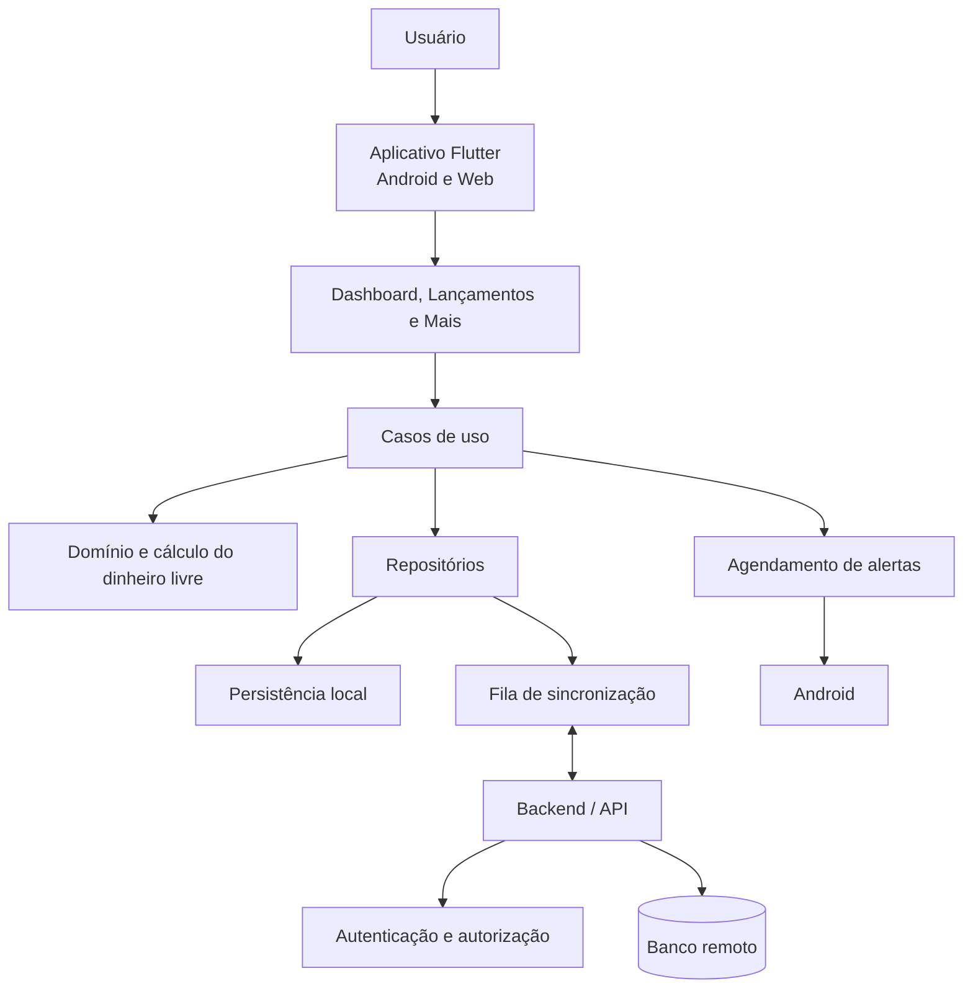

# Arquitetura do Sistema — Norte

**Versão:** 0.5  
**Data:** 08/11/2026  
**Status:** Baseline arquitetural v0.5; stack principal aprovada; detalhamentos técnicos remanescentes (seção 15). Estado de execução: `docs/estado_atual.md`.

## 1. Visão geral

O Norte será um aplicativo Flutter/Dart para Android e Web (iOS fora do MVP — decisão de 10/11/2026). O MVP é um sistema individual de lançamentos financeiros por períodos, com receitas, despesas, destinações simples para investimentos e cálculo do dinheiro livre do período.

A arquitetura não deve incluir módulos de contas bancárias, saldos bancários, Porquinho virtual, reservas, saldo disponível, compras/parcelas de cartão ou carteira de investimentos.

Componentes esperados:

- Interface multiplataforma.
- Autenticação individual.
- Camada de aplicação e regras de domínio.
- Persistência remota.
- Persistência local para operação offline.
- Fila de sincronização e detecção de conflitos.
- Serviço de notificações móveis.

Regras financeiras independem da interface e devem ser testáveis sem widgets.

## 2. Tecnologias

### 2.1 Aprovadas

| Tecnologia | Uso | Status |
|---|---|---|
| Flutter/Dart | Aplicativo multiplataforma | APROVADO |
| Supabase | Backend e autenticação | APROVADO |
| PostgreSQL | Banco remoto | APROVADO |
| SQLite com Drift | Persistência local | APROVADO |
| Riverpod | Gerenciamento de estado | APROVADO |
| GoRouter | Navegação | APROVADO |
| Supabase Auth | Autenticação | APROVADO |
| Serviço próprio em Dart | Sincronização | APROVADO como abordagem |
| `flutter_local_notifications` 23 | Alertas de vencimento agendados no Android (BSD-3; mantido; sem permissão de alarme exato) | APROVADO (Fase 5, Entrega 49) |
| Git | Versionamento | APROVADO |

Plataformas do MVP: Android e Web. iOS fora do MVP (decisão de 10/11/2026); trechos que citam iOS ficam como registro para versão futura.

### 2.2 Detalhamentos técnicos

A stack está aprovada (tabela 2.1). Os detalhamentos de implementação pendentes constam na seção 15 e não alteram essas decisões. A organização dos módulos está na seção 17.1 e a zona `America/Sao_Paulo` por usuário na seção 17.3.

## 3. Princípios arquiteturais

1. **Domínio independente:** regras financeiras não dependem da interface.
2. **Separação de responsabilidades:** apresentação, aplicação, domínio e infraestrutura têm limites claros.
3. **Offline-first:** operações financeiras aprovadas funcionam sem conexão, com implementação incremental desde o início.
4. **Idempotência:** repetição de sincronização não reaplica lançamentos.
5. **Isolamento por usuário:** um usuário não acessa dados de outro.
6. **Precisão financeira:** valores monetários não usam ponto flutuante binário como representação persistente.
7. **Paridade de regras:** cliente e servidor aplicam as mesmas regras e produzem resultados equivalentes para as mesmas entradas.
8. **Simplicidade:** não adicionar módulos, serviços ou abstrações sem necessidade aprovada.
9. **Escopo enxuto:** não reintroduzir contas, Porquinho virtual, compras de cartão ou gestão de investimentos.

## 4. Arquitetura lógica

### 4.1 Componentes

- **Aplicativo Flutter:** telas, navegação e interação.
- **Apresentação:** Dashboard, Lançamentos e Mais.
- **Aplicação:** casos de uso para criar, consultar, editar e cancelar receitas, despesas, investimentos, categorias e períodos.
- **Domínio:** cálculo do dinheiro livre, competência, recorrências, status, validações e regras de auditoria.
- **Repositórios:** contratos de consulta e persistência.
- **Persistência local:** cópia dos dados necessários ao uso offline e fila de operações pendentes.
- **Backend remoto:** autenticação, autorização, validação e persistência sincronizada.
- **Notificações móveis:** alertas de vencimento de despesas.

### 4.2 Fluxo lógico proposto



O diagrama representa separação lógica, não escolha de tecnologias específicas para cada componente.

## 5. Organização do Flutter

### 5.1 Estrutura de diretórios

A estrutura aprovada está na seção 17.1.

### 5.2 Camadas

- **Apresentação:** páginas, formulários, filtros e estados visuais.
- **Aplicação:** casos de uso e coordenação de fluxos.
- **Domínio:** entidades, cálculo do dinheiro livre, competência e regras financeiras.
- **Dados/infraestrutura:** repositórios, banco remoto, armazenamento local, sincronização e notificações.

Riverpod e GoRouter estão aprovados. A seleção de bibliotecas auxiliares permanece sujeita a avaliação técnica.

## 6. Cálculos financeiros

A regra central é:

`Dinheiro livre do período = receitas contabilizadas - despesas contabilizadas - investimentos lançados`.

Competência por tipo de lançamento, efeito do pagamento, edição e cancelamento, ausência de saldo inicial especial e de indicadores de saldo: `docs/regras_negocio.md` (RN004–RN006, RN028–RN030).

## 7. Comunicação com backend

- Validar autorização no servidor mesmo quando a interface ocultar ações.
- Utilizar transações quando uma operação alterar registros relacionados.
- Identificar operações locais com IDs únicos e idempotentes.
- Armazenar o estado de sincronização e falhas recuperáveis.
- Não descartar operações locais em falhas de conectividade.
- Não sobrescrever alterações concorrentes sem política explícita.
- Validar no backend as mesmas regras e casos de referência usados no cálculo local.

O protocolo da API e a política de retentativas ainda serão detalhados. A abordagem de conflitos está aprovada: controle de versão, preservação das versões concorrentes, apresentação ao usuário e consolidação em nova versão, conforme seção 16.1.

## 8. Autenticação e autorização

### 8.1 Fluxos aprovados

- Login com Google.
- Cadastro e login com e-mail e senha.
- Confirmação de e-mail para cadastro tradicional.
- Recuperação de senha por e-mail.
- Bloqueio móvel opcional por PIN ou biometria, solicitado ao abrir o app quando ativado.
- Web utiliza autenticação normal, sem bloqueio móvel adicional.

### 8.2 Pontos técnicos pendentes

- Provedor de identidade e configuração OAuth.
- Gestão de sessão e renovação de tokens.
- Tratamento de conta Google/e-mail com mesmo endereço.
- Proteção e armazenamento seguro do PIN.
- Integração com APIs de biometria.
- Política concreta de autorização no backend.

Autenticação comprova identidade; autorização define quais dados e operações essa identidade pode acessar.

## 9. Segurança e isolamento

- Cada usuário acessa somente seus próprios lançamentos, categorias, recorrências, períodos e configurações.
- A autorização deve ser validada no backend.
- Tokens e credenciais não podem ser gravados no repositório.
- Dados locais devem ser protegidos conforme tecnologia aprovada.
- Logs não devem expor valores ou dados pessoais sem necessidade.
- O compartilhamento não faz parte do MVP.
- Como Supabase/PostgreSQL estão aprovados, definir e testar RLS, chaves estrangeiras e restrições para isolamento por usuário antes da implementação remota.

## 10. Operação offline e sincronização

### 10.1 Escopo offline

**Decisão de 10/11/2026 (APROVADA):** o uso offline vale somente para o aplicativo de celular (Android e iOS). A Web funciona apenas online: não tem banco local, fila de envio nem bloqueio por PIN, e lê e grava direto no servidor com a sessão autenticada (a sessão não é persistida; novo login a cada sessão do navegador). Isso substitui a proposta de KEK/reautenticação para a Web (§17.5) e a pendência de múltiplas abas na Web. A prova técnica da Entrega 11/12 (SQLite3MC em IndexedDB) fica apenas como registro.

O uso offline é essencial. Deve ser implementado incrementalmente desde os primeiros módulos financeiros. O usuário poderá consultar dados sincronizados localmente e criar, editar, cancelar e consultar receitas, despesas, ocorrências recorrentes, destinações para investimentos e categorias, conforme os dados disponíveis no dispositivo.

### 10.2 Requisitos de sincronização

- Persistir localmente antes de apresentar a operação como salva no dispositivo.
- Manter fila de operações pendentes.
- Usar identificadores idempotentes.
- Reenviar operações com segurança após falha transitória.
- Validar no backend usando as mesmas regras do domínio.
- Comparar resultados e identificar divergências.
- Não corrigir ou sobrescrever valores silenciosamente.
- Informar ao usuário quando um conflito exigir decisão.

A política de conflitos aprovada está na seção 16.1.

## 11. Ambientes e dependências

Desenvolvimento, teste e produção devem ser separados. Dados financeiros reais não devem ser usados em desenvolvimento sem política aprovada.

Antes de adicionar pacotes, avaliar compatibilidade com Flutter/Dart, manutenção, licença, segurança, custo e necessidade real no MVP.
Configuração concreta dos ambientes: seção 17.2.

## 12. Estratégia de testes

- **Unitários:** fórmula do dinheiro livre, competência, recorrências, alteração de período, edição e cancelamento.
- **Paridade cliente/backend:** mesmos cenários de referência executados localmente e na validação remota.
- **Integração:** persistência, autenticação, sincronização, auditoria e categorias.
- **Interface:** Dashboard, Lançamentos, Mais, formulários e estados de conexão.
- **Regressão multiplataforma:** Android e Web.

Casos de referência devem cobrir recebimento confirmado, despesa avulsa, despesa recorrente fixa/variável, pagamento sem segunda dedução, investimento simples, cancelamento/edição de lançamento, mês-calendário e ciclo personalizado.

## 13. Distribuição

O MVP será distribuído para Android e Web. **Decisões de 11/11/2026 (Fase 8, APROVADAS):** Web hospedada no Cloudflare Pages (endereço `*.pages.dev`; domínio próprio depois); Android pela Google Play com chave de upload do responsável (fora do repositório) e Play App Signing; monitoramento sem nova dependência (Android Vitals, painel do Supabase, verificação de disponibilidade e tratamento global de erros sem valores financeiros). `applicationId` definitivo usará domínio próprio, ainda a definir. Execução: `docs/entregas_fase8.md`.

## 14. Decisões arquiteturais

| ID | Decisão | Status |
|---|---|---|
| DA001 | Flutter e Dart | APROVADO |
| DA002 | Android e Web no MVP; iOS fora do MVP (alterada em 10/11/2026) | APROVADO |
| DA003 | Uso individual e isolamento por usuário | APROVADO |
| DA004 | Offline essencial, implementado incrementalmente | APROVADO |
| DA005 | Regras no domínio, independentes da UI | APROVADO como princípio |
| DA006 | Backend gerenciado/Supabase e Supabase Auth | APROVADO |
| DA007 | PostgreSQL | APROVADO |
| DA008 | Riverpod para estado e GoRouter para navegação | APROVADO |
| DA009 | SQLite com Drift para persistência local | APROVADO |
| DA010 | Apenas Dashboard, Lançamentos e Mais na navegação principal | APROVADO |
| DA011 | Dinheiro livre do período como único indicador de resultado | APROVADO |

## 15. Detalhamentos técnicos pendentes

Não são decisões de produto pendentes; são detalhamentos necessários antes da implementação correspondente. Backend, banco, autenticação, estado, roteamento, persistência local e política funcional de conflitos estão aprovados e não são pendências. Estado de execução: `docs/estado_atual.md`.

1. Ambientes e configuração operacional (hospedados dev/teste/produção e processo de promoção).
2. Migrations, políticas e testes RLS, constraints e modelo físico; validação no Supabase gerenciado (grants, ownership de funções, RLS).
3. Configuração OAuth, gestão de sessão, autorização e armazenamento seguro por plataforma.
4. Protocolo de sincronização, retentativas e mecanismo técnico para preservar e resolver conflitos segundo a política aprovada. Feitos: envio e conflitos (Entrega 21), versão local após o envio (26), download (27B) e tela de conflitos (22). Validação de ponta a ponta e entre aparelhos: testes automáticos feitos nas Entregas 69–71 (Fase 8, 11/11/2026); falta o roteiro manual e a rodada contra o Supabase hospedado.
5. Notificações móveis: FEITO na Fase 5 (Entrega 49) — `flutter_local_notifications`, notificação diária às 9h (agendamento inexato), janela de 30 dias reagendada ao abrir, sincronizar e salvar, cancelada no logout; Android 13+ pede a permissão de notificações; Web sem alertas. Falta apenas a validação multiplataforma completa (Fase 8).
6. Mecanismo e procedimento de backup, restauração, retenção, exportação CSV e exclusão definitiva.
7. Observabilidade, publicação e compatibilidade dos mecanismos em Android e Web.
8. ~~Estratégia de chaves, criptografia e logout com fila offline~~ — Android validado (Entregas 13–21); Web sem banco local; iOS fora do MVP.
9. Validação de BRL e datas no Flutter Web e paridade Drift/PostgreSQL.
10. Implementar e testar no app os ciclos de dias 29–31 e anos bissextos, os alertas após o fim do período e as consultas dos cinco relatórios.

## 16. Sincronização, segurança e portabilidade

**Data:** 08/11/2026. Stack: seção 2.1. Períodos e recorrências: `docs/regras_negocio.md` (RN036–RN038). Metas de desempenho e alertas: RN043 e RN018.

### 16.1 Sincronização e conflitos
- Registros sincronizáveis possuem controle de versão e cada alteração informa a versão esperada.
- O backend detecta atualizações concorrentes.
- Não adotar “última gravação vence” silencioso. Preservar versões conflitantes e apresentar conflito ao usuário.
- A resolução gera nova versão consolidada e evento rastreável.
- Operações independentes continuam sincronizando; reenvios são idempotentes.
- Operações locais não sincronizadas não podem ser descartadas automaticamente no logout.

#### 16.1.1 Estados da fila de envio e dos conflitos (Entrega 21A — PROPOSTA, aprovada para implementação em 10/11/2026)
**Fila local (`sync_outbox.state`):**
| Estado | Significado |
|---|---|
| `pending` | Gravada localmente, ainda não enviada. |
| `sending` | Envio em andamento. Ao reabrir o app, volta a `pending` (o reenvio é seguro pela chave idempotente). |
| `failed` | Falha transitória (rede, servidor). Reenvio automático em `next_retry_at`, com espera crescente; `attempts` e `last_error` registrados. |
| `conflict` | O servidor detectou versão divergente. A operação fica parada até a resolução; operações independentes seguem. |
| `rejected` | O servidor recusou por regra de domínio ou validação (erro permanente). Exige decisão do usuário; nunca é descartada em silêncio. |

Operação aplicada com sucesso (ou resposta idempotente de reenvio) é **removida** da fila; o registro de que foi aplicada fica em `applied_sync_operations` no servidor. Logo, toda linha existente na fila do usuário é pendência (a contagem do logout continua válida).

**Conflitos (`sync_conflicts.state`, local e servidor):** `open` (aguarda decisão) e `resolved` (decidido, com `resolution` e nova versão consolidada).

**Resolução (aprovada em 10/11/2026):** o usuário escolhe (a) manter a versão do aparelho, (b) manter a do servidor ou (c) editar e salvar uma versão nova. Em (a) e (c) é criada uma nova versão consolidada do registro; em (b) os dados não mudam e o aparelho adota a versão do servidor. Em todos os casos há evento de auditoria (`conflict_resolved`) e as duas versões originais permanecem preservadas no conflito. Conflitos de criação (mesmo identificador já existente) e de período só aceitam (b).

**Conflitos na Web (aprovado em 10/11/2026):** a Web não tem fila local; quando uma gravação dela gera conflito, ele fica aberto no servidor e é apresentado e resolvido na própria Web, na mesma tela de itens que precisam de atenção (Entrega 22).

**Cancelamento x edição concorrentes (aprovado em 10/11/2026):** se um lado cancelou e o outro editou o mesmo lançamento, é conflito e o usuário decide; não há regra automática.

### 16.2 Segurança, backup e portabilidade
- Banco local criptografado; chaves e tokens armazenados em mecanismos seguros adequados a cada plataforma; senhas nunca persistidas em texto puro.
- Bloqueio por PIN/biometria opcional em dispositivos móveis.
- Isolamento por usuário e autorização no backend.
- Backup remoto diário, retenção de 30 dias, procedimento de recuperação, exclusão definitiva e exportação CSV. A restauração deve respeitar exclusões definitivas, evitando ressurreição de dados.
- O fluxo de logout deve resolver operações pendentes antes da limpeza local, com opção/decisão explícita quando não for possível sincronizar.

**Decisões de 11/11/2026 (Fase 8, APROVADAS):**
- **Backup:** dump diário cifrado (dados e autenticação) por GitHub Actions em repositório privado, retenção de 30 dias; push e segredos cadastrados pelo responsável. Restauração reaplica as exclusões de conta registradas. Solução mais robusta pode substituí-la no futuro.
- **Exclusão definitiva da conta:** só com todas as alterações sincronizadas; dupla confirmação; imediata e irreversível, com aviso claro; disponível no app e por página web.
- **CSV:** somente na Web no MVP.
- **Banco local ilegível (chave perdida):** o arquivo é guardado sem apagar, os dados são baixados de novo do servidor e o usuário é avisado; perdem-se só as alterações não sincronizadas. Exceção aprovada à regra de não descartar pendências. Backup automático do Android desligado.
- **Senha mínima:** 8 caracteres nos ambientes hospedados.
- **Conflito após reinstalar:** conflito aberto no servidor não é baixado pelo celular; aparece só na Web (pendência aceita).

## 17. Detalhamento arquitetural da Fase 2 — decisões e propostas

**Status:** Organização de módulos e estratégia de testes aprovadas tecnicamente na Entrega 1 (08/11/2026). A configuração operacional de produção e as dependências Flutter continuam sem aprovação nesta seção. Registro histórico das entregas: `docs/historico/decisoes.md`.

### 17.1 Organização dos módulos

**Status:** APROVADO tecnicamente na Entrega 1 e validado pelo responsável em 08/11/2026; implementação do aplicativo segue na Fase 3.

Organização por funcionalidade, com as camadas internas `presentation`, `application`, `domain` e `data` quando necessárias:

```text
lib/
  app/                 # inicialização, composição e configuração de rotas
  core/                # serviços técnicos transversais
    local_database/    # conexão, schema e migrations Drift
  shared/              # tema e componentes visuais reutilizáveis
  features/
    auth/              # presentation, application, domain e data quando necessários
    dashboard/
    entries/
    recurrence/
    categories/
    periods/
    reports/
    settings/
    sync/

test/                  # espelha lib/ (ex.: test/features/auth/, test/core/local_database/);
                       # unidade, widget e integração convivem por funcionalidade
  generated_migrations/ # gerado pelo Drift para testes de migração

supabase/
  migrations/          # PostgreSQL; somente após aprovação explícita do schema
  tests/
```

**Fase 6:** `features/investments/` (modelos, serviço, repositórios local e remoto, recorrência de investimento e telas de edição da recorrência). O formulário de despesa (`entries/entry_form_screen.dart`) tem o modo investimento (só valor, data e "Repetir"); a geração local de ocorrências fica em `recurrence/local_recurrence_repository.dart` (junto com receitas e despesas, mesmo identificador determinístico). Celular grava no banco local e na fila; Web chama as RPCs, somente online.

**Implementação (Fases 3 e 4):** além das pastas acima existem `core/domain/` (dinheiro BRL em centavos, data civil, períodos, dinheiro livre e relógio `America/Sao_Paulo`, sem acesso a dados), `features/totals/`, `features/attention/` (itens que precisam de atenção) e `features/transactions/` (tela da aba Lançamentos, que usa as regras de `features/entries/`; alinhamento previsto na Entrega 39). Cada funcionalidade com dados tem a interface do repositório, uma implementação local (Drift + fila de envio, celular) e uma remota (Supabase, Web), escolhidas por `dataAccessModeProvider`. Operações da fila declaram dependências (`depends_on` no `payload_json`): uma operação só segue depois que a criação das categorias, subcategorias e períodos de que depende for aplicada (Entrega 35).

As dependências fluem da apresentação para a aplicação e desta para o domínio. A camada `data` implementa contratos de repositório definidos para os casos de uso. `core` contém mecanismos técnicos compartilhados, sem regras financeiras; cada funcionalidade só cria as camadas de que precisa. Riverpod compõe estado e dependências; GoRouter apresenta apenas Dashboard, Lançamentos e Mais na navegação principal. As regras financeiras permanecem no domínio.

### 17.2 Ambientes e configuração

**Status:** stack local do Supabase iniciada em 09/11/2026 com Docker Desktop 29.9.2; migrations locais 20261109000100–20261109000900 aplicadas no banco local. Ambientes Supabase hospedados de desenvolvimento, teste e produção e processo de promoção ainda são PROPOSTA/PENDENTE de provisionamento.

O ambiente local versionado em `supabase/config.toml` usa o projeto lógico `porquinho-dev`; o banco local é isolado dos ambientes hospedados. O seed automático fica desativado até existir fixture sintética aprovada. A suíte PostgreSQL atual cria cluster temporário e usa Auth simulado. As nove migrations existentes também foram aplicadas e conferidas no Supabase local; a validação de RLS e grants no Supabase gerenciado permanece pendente.

**Decisão de 11/11/2026 (APROVADA):** desenvolvimento e testes automatizados usam o Supabase local; hospedados são apenas homologação (plano gratuito) e produção (plano pago), sem compartilhar dados financeiros reais. Provedor de e-mail (SMTP) de produção aguarda a definição do domínio. URLs e chaves públicas serão fornecidas por configuração de build; chaves administrativas, senhas e tokens ficam somente em armazenamento seguro ou gerenciador de segredos do ambiente de execução/CI. Arquivos de exemplo devem conter placeholders, nunca credenciais. Os projetos hospedados ainda dependem de organização/projeto e referências fornecidas pelo responsável, além do processo de promoção.

### 17.3 Datas e geração recorrente

**Status:** APROVADO tecnicamente para representação dos dados e decisão do responsável para a zona operacional.

Datas de competência, vencimento e pagamento serão datas de calendário, sem conversão em instantes. **Geração na sincronização (Fase 5, Entrega 46):** a rodada de sincronização envia períodos e modelos, chama `generate_due_recurrence_occurrences` no servidor antes da primeira alteração de ocorrência, baixa os dados e gera localmente o que ainda faltar; o app gera localmente ao abrir. O identificador da ocorrência é determinístico (modelo + data programada) no app e no servidor, então gerar em dois lugares não duplica. Instantes de auditoria e sincronização usam timestamp com timezone, normalizado em UTC. A zona IANA armazenada por usuário é `America/Sao_Paulo`, aprovada pelo responsável em 08/11/2026. No app, a data corrente nessa zona usa o pacote `timezone` (aprovado em 10/11/2026; avaliação de manutenção e licença na Entrega 32). A data corrente é calculada nessa zona e a geração de ocorrências ocorre ao abrir o aplicativo e durante a sincronização; não há execução em segundo plano.

### 17.4 Persistência local, fila e conflitos

**Status:** Contrato APROVADO na Entrega 1; schema Drift v1 e testes do SQLite nativo implementados na Entrega 9. Conexão persistente criptografada, operação offline transacional e integração do app permanecem pendentes.

O Drift será a fonte de leitura da interface. Uma operação financeira local grava, na mesma transação, o registro, o evento local de auditoria e a operação de saída. A interface só confirma que foi salva após o commit local.

Para preservar centavos exatos no Flutter Web, a modelagem física aprovada na Entrega 2 usa `BigInt` no domínio, texto decimal no SQLite/Drift e string decimal no protocolo de sincronização; o PostgreSQL armazena o valor individual como `BIGINT`. A migration da Entrega 3 preserva inteiros acima de `2^53 - 1` no PostgreSQL. O schema Drift v1 e o round-trip SQLite nativo passaram; o round-trip Drift/Web (SQLite/WASM, valores até 2^63−1, datas e reabertura da conexão) passou na Entrega 10 (`tooling/web_check`); cálculo multiplataforma e persistência Web em IndexedDB ainda precisam de testes.

Cada operação enviada inclui identificador idempotente, usuário autenticado, entidade, versão esperada e conteúdo da alteração. A aplicação remota é transacional: registra o identificador idempotente, valida o proprietário e compara a versão esperada antes de consolidar a nova versão. A repetição do identificador retorna o resultado anterior sem reaplicar efeitos.

Quando a versão esperada não corresponder, o servidor preserva os estados conflitantes e devolve um conflito explícito. O cliente mantém a versão local, apresenta o conflito e suspende operações dependentes daquela entidade; operações independentes continuam. A resolução é uma nova alteração versionada e auditável. Não se usa sobrescrita silenciosa por última gravação.

Escritas remotas são restringidas a funções autenticadas que façam validações e mantenham auditoria na mesma transação. RLS protege leitura própria e grants SQL bloqueiam DML direto. Propriedades das RPCs (`SECURITY DEFINER`, proprietária `postgres`, `search_path` vazio, grants, trava advisory de períodos) e sua cobertura de testes: `docs/banco_de_dados.md` §16.8.4 e §16.9. A validação no Supabase gerenciado permanece pendente.

### 17.5 Proteção local multiplataforma

**Status (atualizado em 10/11/2026):** Android validado no emulador (Entregas 12–21). Web somente online, sem banco local (§10.1). iOS fora do MVP. O texto abaixo preserva o registro da prova técnica.

O banco local deve ser criptografado. Chaves e tokens ficam em armazenamento seguro apropriado à plataforma; senhas não são persistidas.

**Mecanismo proposto:** SQLite3 Multiple Ciphers (pacote `sqlite3` 3.9.1, SQLite 3.54.0, cifra padrão `chacha20`) nas duas famílias de plataforma, nativa via hook `source: sqlite3mc` e Web via `sqlite3mc.wasm`. Chave bruta de 256 bits por `PRAGMA key = "x'<hex>'"`, sem derivação por senha. SQLCipher segue como alternativa nativa; não foi comparado.

**Provado em `tooling/crypto_check` (`dart test`, 10 testes):**
- Nativo (VM, Windows): biblioteca carregada é SQLite3MC; o arquivo não contém texto puro nem o cabeçalho `SQLite format 3`; chave correta lê, chave errada e ausência de chave falham; `PRAGMA rekey` rotaciona a chave e invalida a antiga; Drift (`NativeDatabase` com `setup`) persiste e lê centavos 2^63−1 com a chave.
- Web (Chrome, dart2js): `sqlite3mc.wasm` sobre `IndexedDbFileSystem`; os bytes no IndexedDB não contêm texto puro nem o cabeçalho SQLite; sobrevive a reabrir; chave errada/ausente falha; `rekey` funciona. O banco deve ser aberto com `vfs: 'multipleciphers-<nome do VFS>'`; abrir pelo VFS padrão falha com "Encryption is not supported by the VFS".
- Recuperação de chave na Web: `CryptoKey` AES-GCM não extraível (KEK) guardada em IndexedDB sobrevive a reabrir; `exportKey` é recusado; ela decifra a chave do banco.

**Limitações e pendências:**
1. Android e iOS não foram executados (o repositório não tem projetos `android/` nem `ios/`). A prova nativa foi no Windows; o armazenamento seguro móvel (Keystore/Keychain, p.ex. `flutter_secure_storage`) não foi avaliado.
2. Múltiplas abas não foram testadas; o IndexedDB VFS não coordena escrita concorrente entre abas. Exige teste com travas/worker antes de adotar.
3. Na Web não há armazenamento seguro: a KEK não extraível protege contra exportação da chave, não contra script malicioso no mesmo origin (XSS) nem contra quem usa a sessão do navegador. O ponto de partida da KEK (reautenticação, passphrase) e a política de logout ficam PENDENTES.
4. ~~Drift sobre `sqlite3mc.wasm`/IndexedDB e migração cifrada~~ — provados na Entrega 12 (10/11/2026) com o schema real: `openEncryptedExecutor` (`lib/core/local_database/encrypted_connection*.dart`); na Web a conexão é aberta com `sqlite3.open(vfs: 'multipleciphers-…')` + `WasmDatabase.opened` porque `WasmDatabase()` do Drift não aceita escolher o VFS, e o IndexedDB é gravado após cada escrita/commit. Migração v1→v2 (`stepByStep`) testada em arquivo cifrado nativo e em IndexedDB cifrado, com centavos 2^63−1 preservados. Rodados por `dart test -p chrome` (`tooling/web_check`); o app Flutter Web real não foi executado.
5. Licença do SQLite3 Multiple Ciphers confirmada pelo responsável em 10/11/2026. Custo/exportação de criptografia nas lojas ficam com o responsável. `flutter test --platform chrome` continua indisponível nesta máquina (`dart test` é o runner).
6. O `pubspec.yaml` raiz fixa `hooks.user_defines.sqlite3.source: sqlite3mc`, o que troca o SQLite nativo de todos os builds. A origem da chave (Keystore/Keychain/KEK) segue atrás de `DatabaseKeyProvider` e é PENDENTE. Entrega 13: `StoredDatabaseKeyProvider` e `FlutterSecureValueStore` (Android Keystore) prontos; testados só com armazenamento em memória, nada em dispositivo. **Decisões APROVADAS em 10/11/2026:** celular usa `flutter_secure_storage`; Web exige reautenticação a cada nova sessão para liberar a KEK (opção B), aceitando proteção inferior à do celular; logout com operações não sincronizadas é bloqueado com aviso (sem descarte automático).

**Bloqueio por PIN/biometria (RF003) — APROVADO em 10/11/2026 (`lib/features/app_lock/`):** só no aplicativo móvel; PIN de 6 dígitos (PBKDF2-HMAC-SHA256 com sal, guardado no armazenamento seguro) e biometria opcional como atalho (`local_auth`, BSD-3, oficial do Flutter), com o PIN sempre disponível; pedido apenas ao abrir o app do zero e com sessão ativa. Após 5 erros seguidos há espera crescente (30 s, 1 min, 5 min, 15 min, 1 h), sem apagar dados. O PIN é removido no logout. Ativação em tela provisória "Segurança", a ser movida para "Mais" na Fase 3. Validado no emulador Android (PIN, erros e espera); biometria só coberta por testes automatizados (o emulador não tem digital cadastrada).

### 17.6 Migrations e testes

**Status:** Migrations PostgreSQL/RPCs passaram localmente. Schema Drift v2 (v1 + 4 índices) com migração `stepByStep`, snapshots v1/v2 em `drift_schemas/porquinho/` e `SchemaVerifier` passaram; conexão cifrada validada em Windows e Web (Entrega 12). Android/iOS e integração Supabase gerenciada permanecem pendentes.

Manter migrations PostgreSQL versionadas em `supabase/migrations/`, revisadas e aplicadas primeiro em ambiente local/teste. Drift mantém versão e migrações locais próprias, com snapshots do esquema. Nenhuma migração de produção deve ser aplicada sem revisão e estratégia de evolução/recuperação.

A estratégia de testes foi aprovada na Entrega 1 (08/11/2026).

A estratégia inclui testes unitários de domínio; integração de transações e migrações Drift; testes de migrations, constraints e RLS com pelo menos dois usuários; idempotência, concorrência e conflitos no protocolo; paridade dos casos financeiros locais/remotos; e regressão Android, Web e iOS em ambiente compatível. Casos sintéticos de teste devem ser identificados como fixtures e nunca apresentados como dados reais. A matriz cobre limites `[início, fim)`, meses curtos e anos bissextos, recorrências, edição/cancelamento e pagamento sem segunda dedução.

### 17.7 Portões de aprovação da Fase 2

O schema físico base e as RPCs de categoria, período, subcategoria e ocorrências passaram em PostgreSQL local. A Entrega 5 e a regra de transição após mudança de configuração foram validadas pelo responsável em 09/11/2026. Antes do deploy no Supabase gerenciado, testar versão, grants, ownership de funções e RLS no projeto alvo. Antes de considerar a persistência local multiplataforma preparada, validar criptografia Web e migrações Drift.

### 17.8 Registro de decisões da Fase 2 — atualizado em 09/11/2026

| Tema | Status após revisão | Observação |
|---|---|---|
| Organização por funcionalidade e camadas | APROVADO tecnicamente | Estrutura registrada na seção 17.1; implementação Flutter segue na Fase 3. |
| Contrato offline local e sincronização versionada | APROVADO como desenho arquitetural | Drift, outbox transacional, idempotência e preservação de conflitos; detalhes de protocolo ainda serão testados. |
| Representação de datas de calendário e instantes | APROVADO tecnicamente | Datas de competência não viram timestamps; instantes técnicos em UTC. |
| Estratégia de testes | APROVADO | Execução depende da implementação e de ambientes compatíveis. |
| Separação operacional de ambientes | PROPOSTA | Dev/teste/produção separados; provisionamento e fluxo de promoção ainda não definidos. |
| Zona IANA por usuário (`America/Sao_Paulo`) | APROVADO | Decisão do responsável em 08/11/2026; política de alteração futura permanece pendente. |
| BRL, escala em centavos, zero permitido e negativos/precisão extra rejeitados | APROVADO | Decisão do responsável em 08/11/2026; campos e constraints detalhados na proposta física. |
| Tipo numérico multiplataforma para BRL | APROVADO tecnicamente | `BigInt` no domínio, texto decimal local/no protocolo, `BIGINT` remoto; persistência Web e testes Flutter ainda pendentes. |
| Esquema físico base, nullability e constraints | APROVADO | Validado pelo responsável em 09/11/2026; migration inicial aplicada e testada em PostgreSQL local. |
| FKs `ON DELETE` | APROVADO tecnicamente | `RESTRICT` para impedir remoção acidental; exclusão da conta será operação transacional explícita em entrega futura. |
| RLS de leitura e grants sem DML direto | APROVADO tecnicamente | Migration inicial e testes locais com duas identidades simuladas; projeto Supabase gerenciado ainda pendente. |
| Criptografia local na Web | NÃO SERÁ USADA (Web somente online, decisão de 10/11/2026; prova técnica da Entrega 11 mantida como registro) | SQLite3MultipleCiphers (`sqlite3mc.wasm`) sobre IndexedDB, com chave do banco embrulhada por KEK WebCrypto não extraível. Limitações em §17.5. |
| RPC autenticada de categorias | APROVADO tecnicamente na Entrega 4 | `SECURITY DEFINER`, proprietário `postgres`, identidade via `auth.uid()`, controle de versão, idempotência e auditoria; testada em PostgreSQL local. |
| RPC de criação de períodos | VALIDADA pelo responsável em 09/11/2026 (Entrega 5) | Trava advisory por proprietário, fronteiras semiabertas, idempotência e auditoria; teste concorrente local passou. Regra da primeira fronteira após mudança de configuração também aprovada. |
| RPC autenticada de subcategorias | VALIDADA pelo responsável em 09/11/2026 (Entrega 6); implementada e testada em PostgreSQL local | `SECURITY DEFINER`, proprietário `postgres`, identidade via `auth.uid()`, idempotência, versionamento, conflitos e auditoria. |
| RPCs de lançamentos, modelos e ocorrências recorrentes | IMPLEMENTADAS E TESTADAS LOCALMENTE | Deploy e validação no Supabase gerenciado permanecem pendentes. |

O status distingue migrations e RPCs locais testadas do deploy remoto, ainda pendente.
