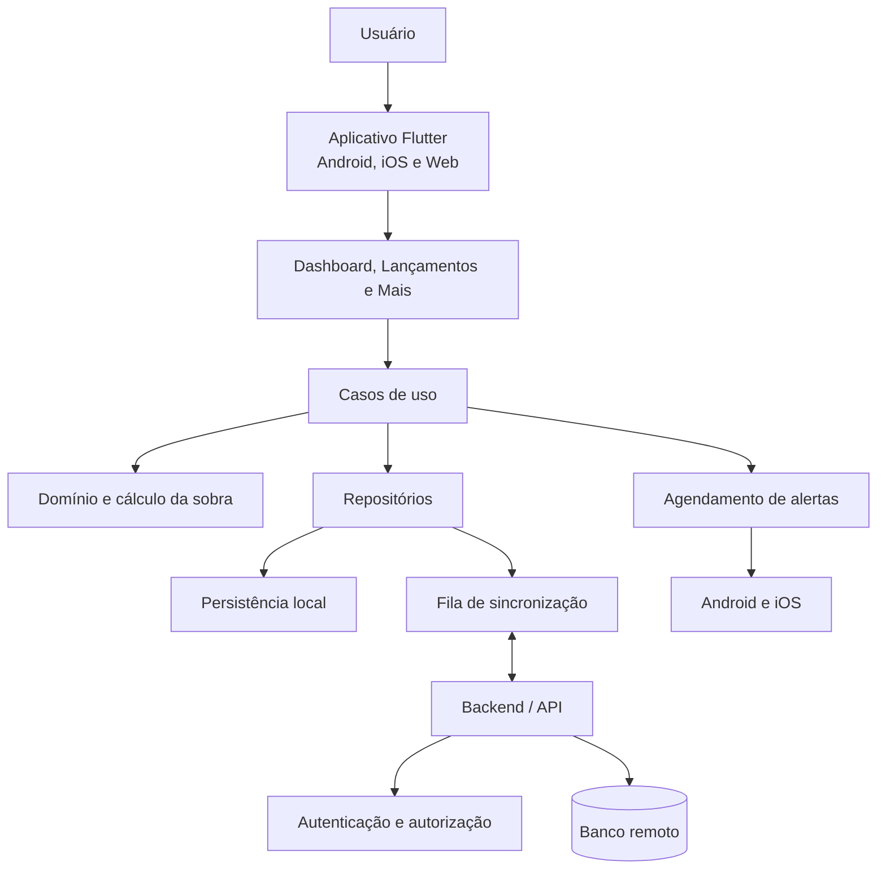

# Arquitetura do Sistema — Porquinho

**Versão:** 0.5  
**Data:** 08/11/2026  
**Status:** Baseline arquitetural v0.5; stack principal aprovada; detalhamentos técnicos remanescentes

## 1. Visão geral

O Porquinho será um aplicativo Flutter/Dart para Android, iOS e Web. O MVP é um sistema individual de lançamentos financeiros por períodos, com receitas, despesas, destinações simples para investimentos e cálculo da sobra do período.

A arquitetura não deve incluir módulos de contas bancárias, saldos bancários, Porquinho virtual, reservas, dinheiro livre, compras/parcelas de cartão ou carteira de investimentos.

Componentes esperados:

- Interface multiplataforma.
- Autenticação individual.
- Camada de aplicação e regras de domínio.
- Persistência remota.
- Persistência local para operação offline.
- Fila de sincronização e detecção de conflitos.
- Serviço de notificações móveis.

Regras financeiras independem da interface e devem ser testáveis sem widgets.

## 2. Tecnologias

### 2.1 Aprovadas

| Tecnologia | Uso | Status |
|---|---|---|
| Flutter/Dart | Aplicativo multiplataforma | APROVADO |
| Supabase | Backend e autenticação | APROVADO |
| PostgreSQL | Banco remoto | APROVADO |
| SQLite com Drift | Persistência local | APROVADO |
| Riverpod | Gerenciamento de estado | APROVADO |
| GoRouter | Navegação | APROVADO |
| Supabase Auth | Autenticação | APROVADO |
| Serviço próprio em Dart | Sincronização | APROVADO como abordagem |
| Git | Versionamento | APROVADO |

Plataformas do MVP: Android, iOS e Web.

### 2.2 Tecnologias aprovadas e detalhamento pendente

A stack foi aprovada conforme a tabela da seção 2.1. A organização concreta dos módulos foi aprovada tecnicamente na Entrega 1 da Fase 2 e está registrada na seção 17.1. A zona `America/Sao_Paulo` por usuário foi definida na Entrega 2. Permanecem pendentes configurações e decisões de implementação: ambientes, migrations, políticas RLS, horário/calendário operacional, observabilidade, chaves e compatibilidade multiplataforma.

### 2.3 Detalhamentos técnicos pendentes

- Protocolo de sincronização, retentativas e implementação técnica da política de conflitos aprovada.
- Configuração de OAuth, sessão e armazenamento de credenciais.
- Estratégia multiplataforma para notificações móveis.
- Ambientes de desenvolvimento, teste e produção.
- Implementação de backup, recuperação, retenção, exportação e exclusão de dados.

Backend, banco, estado, roteamento, persistência local e política funcional de conflitos estão aprovados; organização concreta de módulos está definida na seção 17.1. Os demais detalhes de implementação não alteram essas decisões.

## 3. Princípios arquiteturais

1. **Domínio independente:** regras financeiras não dependem da interface.
2. **Separação de responsabilidades:** apresentação, aplicação, domínio e infraestrutura têm limites claros.
3. **Offline-first:** operações financeiras aprovadas funcionam sem conexão, com implementação incremental desde o início.
4. **Idempotência:** repetição de sincronização não reaplica lançamentos.
5. **Isolamento por usuário:** um usuário não acessa dados de outro.
6. **Precisão financeira:** valores monetários não usam ponto flutuante binário como representação persistente.
7. **Paridade de regras:** cliente e servidor aplicam as mesmas regras e produzem resultados equivalentes para as mesmas entradas.
8. **Simplicidade:** não adicionar módulos, serviços ou abstrações sem necessidade aprovada.
9. **Escopo enxuto:** não reintroduzir contas, Porquinho virtual, compras de cartão ou gestão de investimentos.

## 4. Arquitetura lógica

### 4.1 Componentes

- **Aplicativo Flutter:** telas, navegação e interação.
- **Apresentação:** Dashboard, Lançamentos e Mais.
- **Aplicação:** casos de uso para criar, consultar, editar e cancelar receitas, despesas, investimentos, categorias e períodos.
- **Domínio:** cálculo da sobra, competência, recorrências, status, validações e regras de auditoria.
- **Repositórios:** contratos de consulta e persistência.
- **Persistência local:** cópia dos dados necessários ao uso offline e fila de operações pendentes.
- **Backend remoto:** autenticação, autorização, validação e persistência sincronizada.
- **Notificações móveis:** alertas de vencimento de despesas.

### 4.2 Fluxo lógico proposto



O diagrama representa separação lógica, não escolha de tecnologias específicas para cada componente.

## 5. Organização do Flutter

### 5.1 Organização conceitual por funcionalidades

```text
lib/
  app/                 # Inicialização, configuração global e rotas
  core/                # Erros, segurança, utilitários e serviços transversais
  shared/              # Componentes visuais reutilizáveis
  features/
    auth/              # Autenticação
    dashboard/         # Sobra e resumo do período
    entries/           # Receitas, despesas e investimentos
    recurrence/        # Modelos e ocorrências recorrentes
    categories/        # Categorias e subcategorias de receita/despesa
    periods/           # Mês-calendário e ciclo personalizado
    reports/           # Relatórios básicos
    settings/          # Preferências, tema e segurança
    sync/              # Persistência local e sincronização
```

A estrutura física final depende da aprovação da arquitetura detalhada.

### 5.2 Camadas

- **Apresentação:** páginas, formulários, filtros e estados visuais.
- **Aplicação:** casos de uso e coordenação de fluxos.
- **Domínio:** entidades, cálculo da sobra, competência e regras financeiras.
- **Dados/infraestrutura:** repositórios, banco remoto, armazenamento local, sincronização e notificações.

Riverpod e GoRouter estão aprovados. A seleção de bibliotecas auxiliares permanece sujeita a avaliação técnica.

## 6. Cálculos financeiros

A regra central é:

`Sobra do período = receitas contabilizadas - despesas contabilizadas - investimentos lançados`.

Competência:

- Receita: data efetiva de recebimento.
- Despesa avulsa: data de cadastro/lançamento.
- Despesa recorrente: data de geração da ocorrência.
- Investimento: data do lançamento.

A data de pagamento de uma despesa não gera dedução nem altera seu período de competência. Edição ou cancelamento recalcula o período correspondente. Alteração de data pode mover o lançamento entre períodos.

O sistema não calcula saldo atual, saldo bancário, saldo disponível ou dinheiro livre. Não há campo especial de saldo inicial; categoria criada pelo usuário com esse nome é tratada como receita comum.

## 7. Comunicação com backend

- Validar autorização no servidor mesmo quando a interface ocultar ações.
- Utilizar transações quando uma operação alterar registros relacionados.
- Identificar operações locais com IDs únicos e idempotentes.
- Armazenar o estado de sincronização e falhas recuperáveis.
- Não descartar operações locais em falhas de conectividade.
- Não sobrescrever alterações concorrentes sem política explícita.
- Validar no backend as mesmas regras e casos de referência usados no cálculo local.

O protocolo da API e a política de retentativas ainda serão detalhados. A abordagem de conflitos está aprovada: controle de versão, preservação das versões concorrentes, apresentação ao usuário e consolidação em nova versão, conforme seção 16.3.

## 8. Autenticação e autorização

### 8.1 Fluxos aprovados

- Login com Google.
- Cadastro e login com e-mail e senha.
- Confirmação de e-mail para cadastro tradicional.
- Recuperação de senha por e-mail.
- Bloqueio móvel opcional por PIN ou biometria, solicitado ao abrir o app quando ativado.
- Web utiliza autenticação normal, sem bloqueio móvel adicional.

### 8.2 Pontos técnicos pendentes

- Provedor de identidade e configuração OAuth.
- Gestão de sessão e renovação de tokens.
- Tratamento de conta Google/e-mail com mesmo endereço.
- Proteção e armazenamento seguro do PIN.
- Integração com APIs de biometria.
- Política concreta de autorização no backend.

Autenticação comprova identidade; autorização define quais dados e operações essa identidade pode acessar.

## 9. Segurança e isolamento

- Cada usuário acessa somente seus próprios lançamentos, categorias, recorrências, períodos e configurações.
- A autorização deve ser validada no backend.
- Tokens e credenciais não podem ser gravados no repositório.
- Dados locais devem ser protegidos conforme tecnologia aprovada.
- Logs não devem expor valores ou dados pessoais sem necessidade.
- O compartilhamento não faz parte do MVP.
- Como Supabase/PostgreSQL estão aprovados, definir e testar RLS, chaves estrangeiras e restrições para isolamento por usuário antes da implementação remota.

## 10. Operação offline e sincronização

### 10.1 Escopo offline

O uso offline é essencial. Deve ser implementado incrementalmente desde os primeiros módulos financeiros. O usuário poderá consultar dados sincronizados localmente e criar, editar, cancelar e consultar receitas, despesas, ocorrências recorrentes, destinações para investimentos e categorias, conforme os dados disponíveis no dispositivo.

### 10.2 Requisitos de sincronização

- Persistir localmente antes de apresentar a operação como salva no dispositivo.
- Manter fila de operações pendentes.
- Usar identificadores idempotentes.
- Reenviar operações com segurança após falha transitória.
- Validar no backend usando as mesmas regras do domínio.
- Comparar resultados e identificar divergências.
- Não corrigir ou sobrescrever valores silenciosamente.
- Informar ao usuário quando um conflito exigir decisão.

A estratégia aprovada usa controle de versão, detecção de concorrência, preservação das versões conflitantes, apresentação ao usuário e resolução por nova versão consolidada. Não usar última gravação vence silencioso.

## 11. Ambientes e dependências

Desenvolvimento, teste e produção devem ser separados. Dados financeiros reais não devem ser usados em desenvolvimento sem política aprovada.

Antes de adicionar pacotes, avaliar compatibilidade com Flutter/Dart, manutenção, licença, segurança, custo e necessidade real no MVP.

## 12. Estratégia de testes

- **Unitários:** fórmula da sobra, competência, recorrências, alteração de período, edição e cancelamento.
- **Paridade cliente/backend:** mesmos cenários de referência executados localmente e na validação remota.
- **Integração:** persistência, autenticação, sincronização, auditoria e categorias.
- **Interface:** Dashboard, Lançamentos, Mais, formulários e estados de conexão.
- **Regressão multiplataforma:** Android, iOS e Web.

Casos de referência devem cobrir recebimento confirmado, despesa avulsa, despesa recorrente fixa/variável, pagamento sem segunda dedução, investimento simples, cancelamento/edição de lançamento, mês-calendário e ciclo personalizado.

## 13. Distribuição

O MVP será distribuído para Android, iOS e Web. Lojas, hospedagem web, assinatura de builds, pipeline e procedimentos operacionais permanecem pendentes.

## 14. Decisões arquiteturais

| ID | Decisão | Status |
|---|---|---|
| DA001 | Flutter e Dart | APROVADO |
| DA002 | Android, iOS e Web no MVP | APROVADO |
| DA003 | Uso individual e isolamento por usuário | APROVADO |
| DA004 | Offline essencial, implementado incrementalmente | APROVADO |
| DA005 | Regras no domínio, independentes da UI | APROVADO como princípio |
| DA006 | Backend gerenciado/Supabase e Supabase Auth | APROVADO |
| DA007 | PostgreSQL | APROVADO |
| DA008 | Riverpod para estado e GoRouter para navegação | APROVADO |
| DA009 | SQLite com Drift para persistência local | APROVADO |
| DA010 | Apenas Dashboard, Lançamentos e Mais na navegação principal | APROVADO |
| DA011 | Sobra do período como único indicador de resultado | APROVADO |

## 15. Detalhamentos técnicos pendentes

1. Ambientes e configuração operacional.
2. Migrations, políticas e testes RLS, constraints e modelo físico.
3. Configuração OAuth, gestão de sessão e armazenamento seguro por plataforma.
4. Horário e calendário operacional da geração de recorrências; a zona IANA por usuário está aprovada.
5. Protocolo de sincronização, retentativas e mecanismo técnico para preservar/resolver conflitos segundo a política aprovada.
6. Estratégia de notificações móveis e validação multiplataforma.
7. Mecanismo e procedimento de backup, restauração, retenção, exportação CSV e exclusão definitiva.
8. Observabilidade, publicação e compatibilidade dos mecanismos em Android, iOS e Web.

Backend, banco, autenticação, estado, roteamento, persistência local e política funcional de conflitos estão aprovados na seção 16; não são decisões pendentes.


## 16. Baseline arquitetural v0.5 — decisões aprovadas

**Data:** 08/11/2026. Esta seção substitui classificações anteriores de proposta/pendência para as tecnologias e políticas aqui explicitamente aprovadas.

### 16.1 Stack

| Componente | Tecnologia | Status |
|---|---|---|
| Aplicativo | Flutter/Dart | APROVADO |
| Backend e autenticação | Supabase / Supabase Auth | APROVADO |
| Banco remoto | PostgreSQL | APROVADO |
| Banco local | SQLite com Drift | APROVADO |
| Estado | Riverpod | APROVADO |
| Navegação | GoRouter | APROVADO |
| Sincronização | Serviço próprio em Dart | APROVADO como abordagem |
| Versionamento | Git | APROVADO |

A stack está aprovada; organização concreta de módulos está registrada na seção 17.1. Configuração de ambientes, migrations, RLS, observabilidade, configuração OAuth e compatibilidade de mecanismos por plataforma permanecem detalhamentos técnicos.

### 16.2 Períodos e recorrências

Todos os períodos usam `[início, fim)`. O início é inclusivo e o fim exclusivo. Ciclo personalizado preserva o dia original e, em mês curto, utiliza o último dia disponível; retorna ao dia original no mês seguinte quando possível. Exemplo para dia 31: `[31/01,28/02)`, `[28/02,31/03)`, `[31/03,30/04)`. Mudança de configuração entra em vigor no próximo período.

Recorrências mensais preservam o dia de referência e usam o último dia do mês quando a data não existir. Recorrências por período geram uma ocorrência no início de cada período. Na abertura do app e na sincronização, recuperar ocorrências ausentes. A unicidade lógica e física deve impedir mais de uma ocorrência por modelo e referência programada. Edição de ocorrência não altera o modelo nem outras ocorrências; desativação impede geração futura. A zona por usuário está definida como `America/Sao_Paulo`; horário e calendário operacional devem ser especificados antes de implementar a geração.

### 16.3 Sincronização e conflitos

- Registros sincronizáveis possuem controle de versão e cada alteração informa a versão esperada.
- O backend detecta atualizações concorrentes.
- Não adotar “última gravação vence” silencioso. Preservar versões conflitantes e apresentar conflito ao usuário.
- A resolução gera nova versão consolidada e evento rastreável.
- Operações independentes continuam sincronizando; reenvios são idempotentes.
- Operações locais não sincronizadas não podem ser descartadas automaticamente no logout.

### 16.4 Segurança, backup e portabilidade

- Banco local criptografado; chaves e tokens armazenados em mecanismos seguros adequados a cada plataforma; senhas nunca persistidas em texto puro.
- Bloqueio por PIN/biometria opcional em dispositivos móveis.
- Isolamento por usuário e autorização no backend.
- Backup remoto diário, retenção de 30 dias, procedimento de recuperação, exclusão definitiva e exportação CSV. A restauração deve respeitar exclusões definitivas, evitando ressurreição de dados.
- O fluxo de logout deve resolver operações pendentes antes da limpeza local, com opção/decisão explícita quando não for possível sincronizar.

### 16.5 Desempenho e notificações

Metas iniciais: Dashboard local até 1 s; lista de lançamentos até 1 s; salvamento local até 500 ms; atualização da sobra até 300 ms; lote pequeno de sincronização em conexão normal até 5 s. Medir em dispositivos representativos; metas não são garantias.

Alertas de despesa: três dias antes, no vencimento e diariamente após vencimento enquanto pendente, inclusive após o fim do período. Cessar quando paga ou cancelada e respeitar permissões do dispositivo.

### 16.6 Pendências técnicas remanescentes

Não são decisões de produto pendentes; são detalhamentos necessários antes da implementação correspondente: ambientes; migrations; políticas e testes RLS; estratégia de chaves; sessão e autorização; horário/calendário operacional da geração; estratégia de observabilidade; mecanismo de backup e restauração; validação de armazenamento seguro e criptografia em Android, iOS e Web; política de logout com fila offline. A organização de módulos está definida na seção 17.1 e a zona IANA por usuário foi aprovada na seção 17.8.


## 17. Detalhamento arquitetural da Fase 2 — decisões e propostas

**Status:** Entrega 1 registrada em 08/11/2026. Organização de módulos e estratégia de testes aprovadas tecnicamente para orientar a implementação. O esquema físico, a configuração operacional de produção, as dependências Flutter e as migrations continuam sem aprovação nesta seção.

### 17.1 Organização dos módulos

**Status:** APROVADO tecnicamente na Entrega 1 e validado pelo responsável em 08/11/2026; implementação do aplicativo segue na Fase 3.

Organização por funcionalidade, com as camadas internas `presentation`, `application`, `domain` e `data` quando necessárias:

```text
lib/
  app/                 # inicialização, composição e configuração de rotas
  core/                # serviços técnicos transversais
    local_database/    # conexão, schema e migrations Drift
  shared/              # tema e componentes visuais reutilizáveis
  features/
    auth/              # presentation, application, domain e data quando necessários
    dashboard/
    entries/
    recurrence/
    categories/
    periods/
    reports/
    settings/
    sync/

test/
  unit/
  integration/
  contracts/
  widget/

supabase/
  migrations/          # PostgreSQL; somente após aprovação explícita do schema
  tests/
```

As dependências fluem da apresentação para a aplicação e desta para o domínio. A camada `data` implementa contratos de repositório definidos para os casos de uso. `core` contém mecanismos técnicos compartilhados, sem regras financeiras; cada funcionalidade só cria as camadas de que precisa. Riverpod compõe estado e dependências; GoRouter apresenta apenas Dashboard, Lançamentos e Mais na navegação principal. As regras financeiras permanecem no domínio.

### 17.2 Ambientes e configuração

Propõe-se separar projetos Supabase de desenvolvimento, teste e produção, sem compartilhar dados financeiros reais entre ambientes. URLs e chaves públicas são fornecidas por configuração de build; chaves administrativas, senhas e tokens ficam somente em armazenamento seguro ou gerenciador de segredos do ambiente de execução/CI. Arquivos de exemplo devem conter placeholders, nunca credenciais. A criação dos projetos e o processo operacional de promoção permanecem pendentes de configuração.

### 17.3 Datas e geração recorrente

**Status:** APROVADO tecnicamente para representação dos dados e decisão do responsável para a zona operacional.

Datas de competência, vencimento e pagamento serão datas de calendário, sem conversão em instantes. Instantes de auditoria e sincronização usam timestamp com timezone, normalizado em UTC. A zona IANA armazenada por usuário é `America/Sao_Paulo`, aprovada pelo responsável em 08/11/2026; horário de execução e política para eventual alteração da zona permanecem pendentes.

A geração recupera ocorrências vencidas ao abrir o aplicativo e ao sincronizar; não depende de um agendador em segundo plano. A data corrente é interpretada na zona do usuário. Esta decisão não define um horário de execução nem altera as frequências aprovadas.

### 17.4 Persistência local, fila e conflitos

**Status:** APROVADO como contrato arquitetural inicial na Entrega 1; implementação e testes permanecem pendentes.

O Drift será a fonte de leitura da interface. Uma operação financeira local grava, na mesma transação, o registro, o evento local de auditoria e a operação de saída. A interface só confirma que foi salva após o commit local.

Para preservar centavos exatos no Flutter Web, a modelagem física aprovada na Entrega 2 usa `BigInt` no domínio, texto decimal no SQLite/Drift e string decimal no protocolo de sincronização; o PostgreSQL armazena o valor individual como `BIGINT`. A migration da Entrega 3 preserva inteiros acima de `2^53 - 1` no PostgreSQL. Round-trip Drift/Web e cálculo multiplataforma ainda precisam de testes.

Cada operação enviada inclui identificador idempotente, usuário autenticado, entidade, versão esperada e conteúdo da alteração. A aplicação remota é transacional: registra o identificador idempotente, valida o proprietário e compara a versão esperada antes de consolidar a nova versão. A repetição do identificador retorna o resultado anterior sem reaplicar efeitos.

Quando a versão esperada não corresponder, o servidor preserva os estados conflitantes e devolve um conflito explícito. O cliente mantém a versão local, apresenta o conflito e suspende operações dependentes daquela entidade; operações independentes continuam. A resolução é uma nova alteração versionada e auditável. Não se usa sobrescrita silenciosa por última gravação.

Escritas remotas são restringidas a funções autenticadas que façam validações e mantenham auditoria na mesma transação. RLS protege leitura própria e grants SQL bloqueiam DML direto. As Entregas 4 e 5 implementam RPCs de categoria e período com `SECURITY DEFINER`, proprietária `postgres`, `search_path` vazio, referências qualificadas, execução concedida somente a `authenticated` e proprietário derivado de `auth.uid()`. Como `postgres` ignora RLS, toda consulta e escrita das funções filtra explicitamente por esse usuário. A RPC de período serializa chamadas do mesmo proprietário com trava advisory e valida as fronteiras; testes locais cobrem isolamento e duas chamadas simultâneas. RPCs para outras entidades e validação no Supabase gerenciado permanecem pendentes. A primeira fronteira após alteração da configuração está registrada como PROPOSTA na RN002 até validação do responsável.

### 17.5 Proteção local multiplataforma

**Status:** PENDENTE de prova técnica multiplataforma.

O banco local deve ser criptografado. Avaliar SQLCipher para Android e iOS e fazer uma prova técnica específica para Web antes de selecionar a implementação local final. A prova deve verificar suporte a Drift, persistência, consultas, recuperação de chave e comportamento com múltiplas abas. Não considerar a proteção Web resolvida até documentar o mecanismo e suas limitações. Chaves e tokens ficam em armazenamento seguro apropriado à plataforma; senhas não são persistidas.

### 17.6 Migrations e testes

**Status:** Migrations PostgreSQL de schema, categoria e período testadas localmente nas Entregas 3 a 5; migrations Drift, RPCs das demais entidades e validação no Supabase gerenciado permanecem pendentes.

Manter migrations PostgreSQL versionadas em `supabase/migrations/`, revisadas e aplicadas primeiro em ambiente local/teste. Drift mantém versão e migrações locais próprias, com snapshots do esquema. Nenhuma migração de produção deve ser aplicada sem revisão e estratégia de evolução/recuperação.

**Status:** A estratégia de testes foi aprovada na Entrega 1. Na Entrega 3 passou a suíte da migration PostgreSQL com autenticação simulada; nenhum teste de aplicação Flutter foi executado ainda.

A estratégia inclui testes unitários de domínio; integração de transações e migrações Drift; testes de migrations, constraints e RLS com pelo menos dois usuários; idempotência, concorrência e conflitos no protocolo; paridade dos casos financeiros locais/remotos; e regressão Android, Web e iOS em ambiente compatível. Casos sintéticos de teste devem ser identificados como fixtures e nunca apresentados como dados reais. A matriz cobre limites `[início, fim)`, meses curtos e anos bissextos, recorrências, edição/cancelamento e pagamento sem segunda dedução.

### 17.7 Portões de aprovação da Fase 2

O schema físico base e as RPCs de categoria e período passaram em PostgreSQL local, incluindo duas sessões concorrentes. Antes do deploy no Supabase gerenciado, testar versão, grants, ownership de funções e RLS no projeto alvo. Antes de habilitar escrita para cada entidade, implementar e testar sua RPC transacional. Validar com o responsável a proposta de primeira fronteira após mudança de configuração. Antes de implementar a geração recorrente, definir horário e calendário operacional. Antes de considerar a persistência local multiplataforma preparada, validar criptografia Web e migrações Drift.

### 17.8 Registro de decisões da Fase 2 — atualizado em 09/11/2026

| Tema | Status após revisão | Observação |
|---|---|---|
| Organização por funcionalidade e camadas | APROVADO tecnicamente | Estrutura registrada na seção 17.1; implementação Flutter segue na Fase 3. |
| Contrato offline local e sincronização versionada | APROVADO como desenho arquitetural | Drift, outbox transacional, idempotência e preservação de conflitos; detalhes de protocolo ainda serão testados. |
| Representação de datas de calendário e instantes | APROVADO tecnicamente | Datas de competência não viram timestamps; instantes técnicos em UTC. |
| Estratégia de testes | APROVADO | Execução depende da implementação e de ambientes compatíveis. |
| Separação operacional de ambientes | PROPOSTA | Dev/teste/produção separados; provisionamento e fluxo de promoção ainda não definidos. |
| Zona IANA por usuário (`America/Sao_Paulo`) | APROVADO | Decisão do responsável em 08/11/2026; política de alteração futura permanece pendente. |
| BRL, escala em centavos, zero permitido e negativos/precisão extra rejeitados | APROVADO | Decisão do responsável em 08/11/2026; campos e constraints detalhados na proposta física. |
| Tipo numérico multiplataforma para BRL | APROVADO tecnicamente | `BigInt` no domínio, texto decimal local/no protocolo, `BIGINT` remoto; persistência Web e testes Flutter ainda pendentes. |
| Esquema físico base, nullability e constraints | APROVADO | Validado pelo responsável em 09/11/2026; migration inicial aplicada e testada em PostgreSQL local. |
| FKs `ON DELETE` | APROVADO tecnicamente | `RESTRICT` para impedir remoção acidental; exclusão da conta será operação transacional explícita em entrega futura. |
| RLS de leitura e grants sem DML direto | APROVADO tecnicamente | Migration inicial e testes locais com duas identidades simuladas; projeto Supabase gerenciado ainda pendente. |
| Horário/calendário operacional da geração | PENDENTE | Deve ser definido antes da implementação de recorrências. |
| Criptografia local na Web | PENDENTE | Requer prova técnica antes de escolher mecanismo. |
| RPC autenticada de categorias | APROVADO tecnicamente na Entrega 4 | `SECURITY DEFINER`, proprietário `postgres`, identidade via `auth.uid()`, controle de versão, idempotência e auditoria; testada em PostgreSQL local. |
| RPC de criação de períodos | APROVADO tecnicamente na Entrega 5 | Trava advisory por proprietário, fronteiras semiabertas, idempotência e auditoria; teste concorrente local passou. A primeira fronteira após mudança de configuração está PROPOSTA, aguardando validação do responsável. |
| RPCs para subcategorias, lançamentos e recorrências | PENDENTE | Permanecem sem escrita remota até implementação e testes específicos. |

O status distingue migrations e RPCs locais testadas do deploy remoto e das RPCs das demais entidades ainda pendentes.
