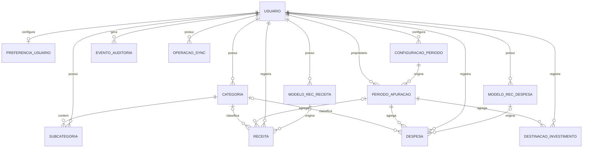

# Banco de Dados — Porquinho

**Versão:** 0.5  
**Data:** 08/11/2026  
**Status:** Modelo conceitual v0.5 revisado; esquema físico permanece para detalhamento técnico

## 1. Visão geral

Este documento descreve os conceitos de dados necessários ao MVP simplificado do Porquinho. Não representa esquema físico aprovado e não autoriza criação de tabelas ou migrations.

O MVP armazena usuários, preferências de período, períodos de apuração, categorias, receitas, despesas, recorrências, destinações simples para investimentos, auditoria e operações de sincronização.

Não haverá entidades para contas bancárias, saldos individuais, saldo inicial especial, Porquinho virtual, reservas, compras/parcelas de cartão, carteira de ativos ou cálculo automático de rendimentos.

## 2. Tecnologia

| Tecnologia | Avaliação | Status |
|---|---|---|
| PostgreSQL | Banco remoto relacional | APROVADO |
| Supabase | Backend gerenciado e autenticação | APROVADO |
| SQLite com Drift | Persistência local offline | APROVADO |

O detalhamento de custo, segurança, isolamento por usuário, portabilidade, manutenção e integração por plataforma continua necessário, mas não reabre a escolha da stack aprovada.

## 3. Princípios de modelagem

- Identificar o usuário proprietário dos dados.
- Preservar histórico de edição e cancelamento.
- Não apagar fisicamente lançamentos financeiros cancelados.
- Representar a data de competência separadamente da data de pagamento quando tiverem significados diferentes.
- Usar valores monetários exatos, sem ponto flutuante binário.
- Manter recorrência-modelo separada de suas ocorrências geradas.
- Garantir idempotência na sincronização.
- Não criar entidades ou campos para funcionalidades fora do MVP.
- O único resultado financeiro calculado é a sobra do período.

## 4. Entidades conceituais

As entidades abaixo são conceitos aprovados para o modelo lógico; não são tabelas aprovadas e não autorizam esquema físico ou migrations.

| Entidade candidata | Finalidade | Status |
|---|---|---|
| Usuário | Identidade e proprietário dos dados | APROVADO (conceito) |
| Preferência do usuário | Tema, modalidade de período e configurações pessoais | APROVADO (conceito) |
| Configuração de período | Regra de mês-calendário ou ciclo personalizado, com vigência | APROVADO (conceito) |
| Período de apuração | Intervalo com início, fim e configuração; sem estado de encerramento manual | APROVADO (conceito) |
| Categoria | Categoria opcional de Receita ou Despesa criada pelo usuário | APROVADO (conceito) |
| Subcategoria | Classificação opcional subordinada à categoria | APROVADO (conceito) |
| Modelo de recorrência de receita | Configuração para gerar ocorrências de receita | APROVADO (conceito) |
| Ocorrência/receita | Receita avulsa ou ocorrência recorrente, com valor, recebimento e status | APROVADO (conceito) |
| Modelo de recorrência de despesa | Configuração para gerar ocorrências de despesa | APROVADO (conceito) |
| Ocorrência/despesa | Despesa avulsa ou ocorrência recorrente, com vencimento, valor e status | APROVADO (conceito) |
| Destinação para investimento | Lançamento simples de valor total destinado, sem ativo ou categoria | APROVADO (conceito) |
| Evento de auditoria | Histórico de criação, edição e cancelamento | APROVADO (conceito) |
| Operação de sincronização | Fila local, idempotência e estado de sincronização | APROVADO (conceito) |

O pagamento de despesa pode ser representado por campos de status e data na ocorrência/despesa, sem entidade separada, caso o modelo físico confirme que pagamentos parciais não fazem parte do MVP.

## 5. Dicionário conceitual

### 5.1 Usuário

Proprietário de lançamentos, categorias, recorrências, preferências e períodos. Campos conceituais: identificador, provedor de autenticação, e-mail, status e datas de criação/atualização.

### 5.2 Preferência e configuração de período

A preferência indica modalidade selecionada (mês-calendário ou ciclo personalizado). A configuração pode incluir dia inicial e data de início de vigência. Alterações só passam a valer no próximo período; períodos históricos preservam a configuração utilizada.

### 5.3 Período de apuração

Representa início inclusivo e fim exclusivo de um ciclo. Deve ter referência à configuração que o criou e associação aos lançamentos conforme suas datas de competência. Não possui estado operacional aberto/encerrado, pois não existe fechamento manual no MVP.

O período não possui saldo inicial bancário nem fotografia de contas. Usa intervalo [início, fim); ciclos personalizados preservam o dia original e usam o último dia disponível em meses curtos.

### 5.4 Categoria e subcategoria

Categoria pertence a um usuário e possui tipo imutável: Receita ou Despesa. Inclui nome, status ativo/inativo e datas. A associação de categoria a receitas e despesas é opcional. Subcategoria também é opcional. Categorias utilizadas devem ser desativadas, não apagadas, para preservar o histórico.

Destinações para investimento não usam categorias.

### 5.5 Modelo de recorrência

Modelos de recorrência de receita e de despesa são entidades conceituais separadas. Campos conceituais: usuário, descrição, tipo, frequência (mensal ou por período), data de início, valor padrão quando fixo, indicador fixo/variável, categoria quando aplicável, vencimento quando aplicável e status ativo/inativo.

O tratamento funcional de datas inexistentes está aprovado: usar o último dia do mês, preservando a referência original para meses seguintes. Horário e timezone de geração permanecem detalhamento técnico.

### 5.6 Receita

Representa receita avulsa efetivamente recebida ou ocorrência de receita recorrente. Campos conceituais: usuário, descrição, categoria opcional, valor, data efetiva de recebimento, referência opcional ao modelo/ocorrência, status (pendente/recebida/cancelada), período de apuração e metadados de auditoria. Uma ocorrência recorrente ainda pendente não possui data efetiva de recebimento nem competência financeira; associá-la a um período para cálculo somente após a confirmação do recebimento. Receita avulsa e receita recorrente recebida devem pertencer a um período.

Receita recorrente é gerada pendente e só compõe a sobra após confirmação do recebimento. O valor da ocorrência pode ser editado sem alterar o modelo nem futuras ocorrências.

### 5.7 Despesa

Representa despesa avulsa ou ocorrência de recorrência. Campos conceituais: usuário, descrição, categoria opcional, valor, data de cadastro/geração (competência), vencimento opcional, data efetiva do pagamento, status (pendente/paga/cancelada), referência opcional ao modelo e período de apuração. Toda despesa pertence a um período.

Despesa avulsa entra na sobra no cadastro. Despesa recorrente entra ao ser gerada e ter valor definido. Pagamento não gera dedução adicional. Despesa pendente não é transportada financeiramente para o período seguinte; permanece no histórico do período de origem.

### 5.8 Fatura de cartão

Não existe entidade Cartão ou Fatura. A fatura é representada por uma despesa recorrente variável comum, com descrição livre. Não modelar compras, parcelas, fechamento ou limite.

### 5.9 Destinação para investimento

Lançamento simples com usuário, valor, data e período de apuração. Não possui descrição obrigatória, categoria de ativo, instituição, quantidade, posição, rentabilidade ou status de pagamento. O valor é deduzido da sobra assim que registrado. O Dashboard apresenta um único total de valores destinados a investimentos no período.

### 5.10 Evento de auditoria

Registra entidade afetada, identificador do registro, usuário, operação (criação, edição, cancelamento ou mudança de status), valores anteriores e novos quando aplicável, data/hora e justificativa opcional. A referência à entidade afetada pode ser polimórfica, desde que validada de forma segura.

### 5.11 Operação de sincronização

Registra identificador idempotente, usuário, instalação/dispositivo, tipo de operação, referência local, estado, tentativas, datas e erro recuperável. O desenho final depende da tecnologia local/remota aprovada.

## 6. Relacionamentos conceituais

- Um usuário possui várias categorias, subcategorias, recorrências, receitas, despesas, destinações para investimento, períodos e eventos de auditoria.
- Uma configuração de período pode originar vários períodos de apuração ao longo do tempo.
- Cada período de apuração referencia a configuração usada na sua criação.
- Um período reúne receitas, despesas e destinações para investimento de acordo com as datas de competência.
- Uma categoria de Receita pode classificar várias receitas; uma categoria de Despesa pode classificar várias despesas.
- Uma categoria pode ter várias subcategorias; cada subcategoria pertence a uma categoria.
- Um modelo de recorrência pode gerar várias ocorrências do tipo correspondente.
- Uma receita pode ser avulsa ou originada de um modelo de recorrência.
- Uma despesa pode ser avulsa ou originada de um modelo de recorrência.
- Uma despesa pode registrar status e data de pagamento; pagamentos parciais não fazem parte do MVP.
- Uma destinação para investimento pertence a um usuário e a um período, sem referência a ativo ou classe de investimento.
- Eventos de auditoria identificam usuário e registro afetado.
- Operações de sincronização pertencem ao usuário e referenciam uma operação financeira ou de configuração.

## 7. Diagrama entidade-relacionamento conceitual

O diagrama AUD-05 revisado e vigente está na seção 15.5. Ele substitui versões anteriores e deve ser lido em conjunto com o catálogo de entidades; não autoriza esquema físico ou migrations.

## 8. Cálculo e representação monetária

- Persistir valores em representação decimal exata ou unidade mínima inteira, conforme tecnologia aprovada.
- Não usar float/double binário para persistência monetária.
- Centralizar a fórmula da sobra no domínio.
- Sobra do período = receitas contabilizadas - despesas contabilizadas - destinações para investimentos.
- Não há saldo inicial especial, saldo bancário, dinheiro livre ou saldo disponível.

Critérios de arredondamento e representação física dependem da decisão técnica.

## 9. Integridade e consistência

- Cada registro financeiro pertence a um usuário.
- Categorias devem pertencer ao mesmo usuário dos lançamentos associados.
- Categoria tem tipo imutável (Receita/Despesa).
- Lançamentos cancelados não participam dos cálculos, mas permanecem armazenados.
- Edição ou cancelamento recalcula os períodos afetados.
- Alteração da data de competência pode mover o lançamento para outro período.
- Confirmação de pagamento de despesa não deve duplicar dedução.
- Confirmação de recebimento de receita recorrente contabiliza o valor uma única vez.
- Sincronização repetida não aplica novamente a mesma operação.

## 10. Segurança e isolamento

A autorização deve garantir que cada usuário acesse apenas seus próprios lançamentos, categorias, recorrências, períodos e eventos. Segredos não devem ser persistidos no repositório. Como PostgreSQL/Supabase estão aprovados, definir e testar RLS e restrições referenciais antes da implementação remota.

## 11. Histórico e auditoria

Toda edição, cancelamento ou mudança de status relevante deve gerar evento de auditoria com usuário, registro afetado, instante e dados anteriores/novos quando aplicável. Lançamentos cancelados não devem ser apagados fisicamente.

## 12. Índices e desempenho

Índices, chaves e tipos SQL só serão definidos após escolha do banco e validação do modelo lógico. Consultas esperadas incluem lançamentos por usuário/período, receitas e despesas por categoria, ocorrências de recorrência e fila de sincronização.

## 13. Migrations e evolução

Backend, banco, modelo lógico conceitual e política funcional de sincronização estão aprovados. Criar tabelas físicas ou migrations somente após concluir o esquema físico, constraints, RLS e detalhes técnicos de sincronização. Mudanças futuras devem ser versionadas, revisáveis e acompanhadas de estratégia de evolução/reversão quando aplicável.

## 14. Pendências de modelagem

1. Definir esquema físico, tipos, índices e constraints após validar o modelo lógico.
2. Detalhar horário/timezone e calendário operacional da geração.
3. Especificar fila offline, versionamento e persistência das versões conflitantes.
4. Detalhar retenção, restauração, exclusão definitiva e exportação.
5. Validar tecnicamente a integridade das referências polimórficas de auditoria e sincronização.

## 15. Baseline conceitual v0.5 — decisões e ajustes

**Data:** 08/11/2026. Esta seção prevalece sobre trechos anteriores que indiquem como pendentes decisões aqui aprovadas. O esquema físico continua sujeito a detalhamento; esta baseline não autoriza migrations.

### 15.1 Períodos

- Períodos usam `[data_inicio, data_fim)`: início inclusivo e fim exclusivo.
- Não armazenar estado operacional aberto/encerrado: o MVP não possui fechamento manual. Se houver estado técnico de sincronização ou processamento, nomear e documentar separadamente, sem confundir com encerramento do período.
- Períodos históricos mantêm a configuração de período que os originou. Alterações de configuração passam a valer no próximo período.
- Ciclo personalizado preserva o dia inicial original. Em mês curto, usa o último dia disponível; retorna ao dia original no mês seguinte quando possível. Exemplo dia 31: `[31/01,28/02)`, `[28/02,31/03)`, `[31/03,30/04)`.

### 15.2 Modelos e ocorrências recorrentes

Manter entidades/modelos separados para recorrência de receita e recorrência de despesa. Ambos pertencem diretamente a um usuário. Cada ocorrência pertence ao usuário e referencia seu modelo de origem.

Campos conceituais adicionais para modelos: identificador do usuário proprietário, frequência, data de início/vigência, dia de referência (quando mensal), estado ativo/inativo e parâmetros necessários à geração. Para ocorrência: modelo de origem, referência programada/competência, data efetiva, estado, valor e metadados de auditoria.

A combinação modelo + referência programada deve ser única, inclusive por restrição no banco, para garantir idempotência. Ocorrências atrasadas podem ser recuperadas na abertura do app e na sincronização. Edição individual não modifica modelo ou outras ocorrências; desativação preserva ocorrências existentes e impede futuras. Horário e timezone de geração ainda exigem especificação técnica.

A semântica canônica da referência usada na chave de unicidade (data programada mensal ou identificador de competência do período) deve ser definida no detalhamento técnico, preservando a regra funcional aprovada de uma ocorrência por referência.

### 15.3 Categorias, pagamentos e alertas

Categorias e subcategorias pertencem ao usuário proprietário. Categorias não são excluídas fisicamente; status ativo/inativo controla sua disponibilidade em novos lançamentos. Históricos mantêm referência à categoria original. Renomeação não reescreve lançamentos históricos.

Despesa possui pagamento integral, sem entidade de pagamento parcial nem saldo restante no MVP. Status e data efetiva do pagamento não geram nova dedução. Alertas permanecem ativos após o término do período enquanto a despesa estiver pendente e cessam ao pagar ou cancelar.

### 15.4 Auditoria e sincronização

Toda entidade de domínio deve ter proprietário identificável por usuário, inclusive modelos recorrentes, subcategorias, configurações/períodos e operações sincronizáveis. Eventos de auditoria registram usuário, entidade/registro afetado, operação, instante e valores anteriores/novos quando aplicável.

Operações de sincronização pertencem a um usuário e devem referenciar origem/registro local, identificador idempotente, versão esperada, estado, tentativas e resultado. Registros sincronizáveis possuem versão. Conflitos preservam as versões concorrentes e a resolução gera nova versão consolidada; não aplicar sobrescrita silenciosa.

### 15.5 Diagrama conceitual revisado — AUD-05

A relação de `EVENTO_AUDITORIA` com a entidade afetada é polimórfica e deve ser validada pela aplicação ou por mecanismo de integridade equivalente. `OPERACAO_SYNC` referencia a origem/registro por identificador tipado; essa relação polimórfica é intencionalmente omitida do Mermaid e sua integridade deve ser verificada no processo de sincronização. Todas as relações entre entidades de usuário devem impedir referência cruzada entre proprietários. Cada usuário pode ter zero ou uma preferência; cada preferência pertence a exatamente um usuário.

As relações de categoria para receita/despesa são opcionais por decisão aprovada: todo lançamento pode ter zero ou uma categoria compatível, pertencente ao mesmo usuário. Cada receita e despesa é avulsa ou originada de um modelo recorrente; lançamentos avulsos não referenciam modelo, e ocorrências recorrentes referenciam exatamente um modelo do tipo correspondente. A associação da receita ao período é opcional apenas enquanto uma receita recorrente está pendente; receitas avulsas, receitas recorrentes recebidas, despesas e destinações de investimento pertencem a exatamente um período. Relatórios por categoria agrupam lançamentos sem classificação em **Sem categoria**, sem removê-los dos totais gerais.

### 15.6 Backup, exclusão e exportação

O modelo deve suportar exportação CSV dos dados financeiros do usuário e exclusão definitiva. Backup remoto diário com retenção de 30 dias e restauração controlada. Definir tombstones ou mecanismo equivalente para que registros excluídos não reapareçam após sincronização/restauração. A política de retenção legal/técnica e propagação de exclusões aos backups deve ser especificada na arquitetura.

### 15.7 Metas de consulta

Metas iniciais: Dashboard local até 1 s; lista até 1 s; salvamento local até 500 ms; cálculo da sobra até 300 ms; sincronização de lote pequeno até 5 s em conexão normal. Validar por medição antes de tratar como critério de aceite final.

## 16. Proposta de esquema físico inicial

**Status:** PROPOSTA — aguarda revisão e aprovação. Este desenho detalha o modelo conceitual v0.5; não autoriza migrations nem cria novas regras funcionais.

### 16.1 Convenções e propriedade

O Supabase Auth (`auth.users`) é a fonte da identidade; não se propõe duplicar a tabela de usuários. Entidades do aplicativo usam UUID gerado no cliente, `owner_id` UUID obrigatório, `version` inteira crescente e timestamps de criação/atualização. A chave lógica principal é `(owner_id, id)` para permitir referências compostas que impeçam relações entre proprietários diferentes.

Proposta de mapeamento:

| Conceito | Tabela candidata | Campos físicos principais |
|---|---|---|
| Preferência | `user_preferences` | `owner_id` (único), tema e configuração vigente |
| Configuração de período | `period_configurations` | `id`, `owner_id`, modalidade, dia inicial quando aplicável, início de vigência |
| Período | `accounting_periods` | `id`, `owner_id`, configuração de origem, `start_date`, `end_date` |
| Categoria | `categories` | `id`, `owner_id`, tipo imutável, nome, ativo/inativo |
| Subcategoria | `subcategories` | `id`, `owner_id`, `category_id`, nome, ativo/inativo |
| Modelo de receita recorrente | `income_recurrence_templates` | proprietário, frequência, parâmetros de agenda, valor fixo/variável, categoria opcional, ativo/inativo |
| Modelo de despesa recorrente | `expense_recurrence_templates` | proprietário, frequência, parâmetros de agenda, valor fixo/variável, categoria e vencimento quando aplicáveis, ativo/inativo |
| Receita | `income_entries` | proprietário, descrição, valor, recebimento, status, categoria e período opcionais, modelo e referência programada opcionais |
| Despesa | `expense_entries` | proprietário, descrição, valor, data de competência, vencimento/pagamento, status, categoria opcional, período e modelo opcionais conforme origem |
| Destinação para investimento | `investment_allocations` | proprietário, valor, data do lançamento e período; sem categoria ou status de pagamento |
| Auditoria | `audit_events` | proprietário, entidade/tipo, operação, instante, snapshots anteriores/novos |
| Idempotência remota | `applied_sync_operations` | proprietário, chave idempotente, resultado e instante de aplicação |
| Conflito remoto | `sync_conflicts` | proprietário, entidade, versão-base, snapshots concorrentes, estado e resolução |
| Fila local | `sync_outbox` | chave idempotente, entidade, versão esperada, payload, tentativas, estado e próximo retry |

`sync_outbox` é local. As tabelas remotas de operações aplicadas e conflitos apoiam idempotência e resolução; não substituem os registros de domínio. Campos opcionais e suas combinações devem ser fechados contra o fluxo funcional de cada entidade antes da migration.

### 16.2 Tipos e constraints propostas

No PostgreSQL, propõem-se `uuid`, `date`, `timestamptz`, `bigint`, `boolean`, enums ou `text` com `CHECK`, conforme compatibilidade de evolução. No SQLite/Drift, IDs e enums podem ser `TEXT`, valores inteiros `INTEGER`, datas ISO `YYYY-MM-DD` e instantes ISO UTC; datas devem continuar sendo datas, sem conversão por timezone.

Para valores monetários, propõe-se unidade mínima inteira em `BIGINT` no PostgreSQL e `INTEGER` de 64 bits no SQLite, sem ponto flutuante. Centavos/BRL são uma hipótese inicial, não decisão aprovada: moeda, escala permitida, limite e tratamento de entradas com mais casas precisam ser confirmados. Não aplicar arredondamento implícito.

Constraints propostas:

- `start_date < end_date` para períodos, com intervalos semiabertos;
- unicidade do período por proprietário e início, além de prevenção de sobreposição;
- chaves estrangeiras compostas por proprietário para categoria, subcategoria, período e modelo de recorrência;
- unicidade de ocorrência recorrente por proprietário, modelo e referência programada, aplicável somente às ocorrências com modelo;
- unicidade da chave idempotente por proprietário;
- ausência de `period_id` em receita recorrente ainda pendente e associação a período após recebimento;
- categoria opcional, sempre compatível com o tipo e proprietário do lançamento;
- investimento sem categoria, sem pagamento e sem descrição obrigatória.

O mecanismo físico de prevenção de sobreposição de períodos (por exemplo, constraint de exclusão ou validação transacional equivalente) depende da validação de extensões disponíveis no PostgreSQL gerenciado. A data de competência e o período associado também precisam ser validados na mesma transação; uma `CHECK` simples não valida outra linha/tabela.

### Índices candidatos

Além das chaves e índices únicos das constraints, propõem-se índices iniciados por `owner_id` para refletir as consultas aprovadas: lançamentos por período/data; receitas e despesas por período/categoria; períodos por início; eventos de auditoria por entidade e instante; e modelos/ocorrências por referência programada. A fila local pode indexar estado e próximo retry. O plano de consulta deve validar esses candidatos com dados representativos antes de fixá-los; índices redundantes às constraints não devem ser criados.

### 16.3 RLS e autorização

RLS será habilitada em todas as tabelas remotas que contenham dados de usuário. A política-base exige `auth.uid() = owner_id` em leitura e escrita, além de validação da identidade nas funções de sincronização. Tabelas filhas precisam validar o mesmo proprietário por referência composta. Acesso anônimo é negado. A proposta é não conceder escrita direta às tabelas financeiras: operações passam por funções autenticadas e transacionais que validam regras, versão esperada, auditoria e idempotência.

O conjunto de testes deve criar dois usuários e demonstrar que cada um lê e altera apenas suas linhas; referências a categoria, período ou recorrência de outro usuário falham; usuário anônimo não acessa dados; e repetir uma operação idempotente não duplica alteração nem auditoria.

### 16.4 Auditoria e sincronização

`audit_events` é append-only para o fluxo normal. Como a referência ao registro afetado é polimórfica, a proposta exige que a função transacional valide tipo, ID e proprietário antes de gravar os snapshots. Valores sensíveis não necessários não devem ser incluídos nos snapshots.

Cada linha sincronizável tem versão. A aplicação remota compara a versão esperada, registra a nova versão e o evento de auditoria atomicamente, ou preserva os snapshots concorrentes em `sync_conflicts`. `applied_sync_operations` possui chave única por proprietário e operação, guardando resposta suficiente para reenvio idempotente. Resolução de conflito cria uma nova versão; não atualiza silenciosamente um estado concorrente.

### 16.5 Migrations e evolução

Migrations PostgreSQL seriam mantidas em `supabase/migrations/`, ordenadas e revisáveis. A aplicação local de teste deve começar de banco vazio, aplicar toda a sequência e executar testes de constraints/RLS. Produção recebe migrations já aplicadas e verificadas em ambiente de teste, com estratégia documentada de evolução e recuperação.

Drift mantém `schemaVersion`, snapshots gerados e migrações locais independentes. Cada migração local deve ser testada da versão anterior para a nova, preservando dados. O contrato lógico e casos de paridade são comuns aos dois armazenamentos; tipos e scripts de migration não precisam ser idênticos.

### 16.6 Pendências antes da aprovação do esquema

1. Confirmar moeda, escala, limites e validação de precisão monetária sem arredondamento implícito.
2. Aprovar campos e nullability de receita/despesa recorrente pendente, especialmente valor variável e período.
3. Definir a representação canônica da referência mensal e por período e a respectiva constraint.
4. Validar mecanismo de não sobreposição de períodos disponível no Supabase/PostgreSQL.
5. Aprovar tipos, índices, política de exclusão definitiva/tombstones e retenção de auditoria.
6. Testar compatibilidade de criptografia e armazenamento local em Android, iOS e Web antes da implementação correspondente.

Até a resolução dessas pendências e aprovação explícita do esquema físico, este documento permanece PROPOSTA e nenhuma migration definitiva deve ser criada.
