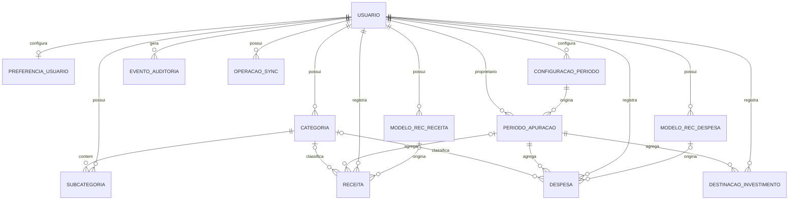

# Banco de Dados — Norte

**Versão:** 0.5  
**Data da última atualização:** 09/11/2026
**Status:** Modelo conceitual v0.5 e schema físico-base aprovados; migrations PostgreSQL/RPCs testadas localmente e schema Drift v1 criado/testado em SQLite nativo. Abertura persistente criptografada, validação Web e integração Supabase gerenciado ainda pendentes.

## 1. Visão geral

Este documento registra o modelo conceitual aprovado e o schema físico-base aprovado em 09/11/2026. As migrations PostgreSQL estão em `supabase/migrations/`; RPCs até o ciclo de vida de ocorrências recorrentes foram implementadas e testadas localmente nas Entregas 7A a 8. A validação no Supabase gerenciado permanece pendente. A regra de transição na primeira fronteira após mudança de período foi aprovada pelo responsável em 09/11/2026 e está descrita na RN002. O schema não autoriza entidades fora do escopo aprovado.

O MVP armazena usuários, preferências de período, períodos de apuração, categorias, receitas, despesas, recorrências, destinações simples para investimentos, auditoria e operações de sincronização.

Não haverá entidades para contas bancárias, saldos individuais, saldo inicial especial, Porquinho virtual, reservas, compras/parcelas de cartão, carteira de ativos ou cálculo automático de rendimentos.

## 2. Tecnologia

PostgreSQL, Supabase e SQLite com Drift estão APROVADOS (`docs/arquitetura.md` §2.1). O detalhamento de custo, segurança, isolamento por usuário, portabilidade, manutenção e integração por plataforma continua necessário, mas não reabre a escolha da stack aprovada.

## 3. Princípios de modelagem

- Identificar o usuário proprietário dos dados.
- Preservar histórico de edição e cancelamento.
- Não apagar fisicamente lançamentos financeiros cancelados.
- Representar a data de competência separadamente da data de pagamento quando tiverem significados diferentes.
- Usar valores monetários exatos, sem ponto flutuante binário.
- Manter recorrência-modelo separada de suas ocorrências geradas.
- Garantir idempotência na sincronização.
- Não criar entidades ou campos para funcionalidades fora do MVP.
- O único resultado financeiro calculado é o dinheiro livre do período.

## 4. Entidades conceituais

As entidades abaixo são conceitos aprovados do modelo lógico; as tabelas físicas aprovadas estão na seção 16.8.

| Entidade candidata | Finalidade | Status |
|---|---|---|
| Usuário | Identidade e proprietário dos dados | APROVADO (conceito) |
| Preferência do usuário | Tema, progresso do assistente inicial e zona de calendário (a configuração de período fica em `period_configurations`) | APROVADO (conceito) |
| Configuração de período | Regra de mês-calendário ou ciclo personalizado, com vigência | APROVADO (conceito) |
| Período de apuração | Intervalo com início, fim e configuração; sem estado de encerramento manual | APROVADO (conceito) |
| Categoria | Categoria opcional de Receita ou Despesa criada pelo usuário | APROVADO (conceito) |
| Subcategoria | Classificação opcional subordinada à categoria | APROVADO (conceito) |
| Modelo de recorrência de receita | Configuração para gerar ocorrências de receita | APROVADO (conceito) |
| Ocorrência/receita | Receita avulsa ou ocorrência recorrente, com valor, recebimento e status | APROVADO (conceito) |
| Modelo de recorrência de despesa | Configuração para gerar ocorrências de despesa | APROVADO (conceito) |
| Ocorrência/despesa | Despesa avulsa ou ocorrência recorrente, com vencimento, valor e status | APROVADO (conceito) |
| Destinação para investimento | Lançamento simples de valor total destinado, sem ativo ou categoria | APROVADO (conceito) |
| Evento de auditoria | Histórico de criação, edição e cancelamento | APROVADO (conceito) |
| Operação de sincronização | Fila local, idempotência e estado de sincronização | APROVADO (conceito) |

O pagamento de despesa pode ser representado por campos de status e data na ocorrência/despesa, sem entidade separada, caso o modelo físico confirme que pagamentos parciais não fazem parte do MVP.

## 5. Dicionário conceitual

### 5.1 Usuário

Proprietário de lançamentos, categorias, recorrências, preferências e períodos. Campos conceituais: identificador, provedor de autenticação, e-mail, status e datas de criação/atualização.

### 5.2 Preferência e configuração de período

A preferência indica modalidade selecionada (mês-calendário ou ciclo personalizado). A configuração pode incluir dia inicial e data de início de vigência. Alterações só passam a valer no próximo período; períodos históricos preservam a configuração utilizada.

### 5.3 Período de apuração

Representa início inclusivo e fim exclusivo de um ciclo. Deve ter referência à configuração que o criou e associação aos lançamentos conforme suas datas de competência. Não possui estado operacional aberto/encerrado, pois não existe fechamento manual no MVP.

O período não possui saldo inicial bancário nem fotografia de contas. Intervalos e ciclos: RN036–RN037 (`docs/regras_negocio.md`).

### 5.4 Categoria e subcategoria

Categoria pertence a um usuário e possui tipo imutável: Receita ou Despesa. Inclui nome, status ativo/inativo e datas. A associação de categoria a receitas e despesas é opcional. Subcategoria também é opcional. Categorias utilizadas devem ser desativadas, não apagadas, para preservar o histórico.

Destinações para investimento não usam categorias.

### 5.5 Modelo de recorrência

Modelos de recorrência de receita e de despesa são entidades conceituais separadas. Campos conceituais: usuário, descrição, tipo, frequência (mensal ou por período), data de início, valor padrão quando fixo, indicador fixo/variável, categoria quando aplicável, vencimento quando aplicável e status ativo/inativo.

Datas inexistentes e geração ao abrir o app e sincronizar: RN038. `America/Sao_Paulo` por usuário foi aprovado em 08/11/2026.

### 5.6 Receita

Representa receita avulsa efetivamente recebida ou ocorrência de receita recorrente. Campos conceituais: usuário, descrição, categoria opcional, valor, data efetiva de recebimento, referência opcional ao modelo/ocorrência, status (pendente/recebida/cancelada), período de apuração e metadados de auditoria. Uma ocorrência recorrente ainda pendente não possui data efetiva de recebimento nem competência financeira; associá-la a um período para cálculo somente após a confirmação do recebimento. Receita avulsa e receita recorrente recebida devem pertencer a um período.

Receita recorrente é gerada pendente e só compõe o dinheiro livre após confirmação do recebimento. O valor da ocorrência pode ser editado sem alterar o modelo nem futuras ocorrências.

### 5.7 Despesa

Representa despesa avulsa ou ocorrência de recorrência. Campos conceituais: usuário, descrição, categoria opcional, valor, data de cadastro/geração (competência), vencimento opcional, data efetiva do pagamento, status (pendente/paga/cancelada), referência opcional ao modelo e período de apuração. Toda despesa pertence a um período.

Despesa avulsa entra no dinheiro livre no cadastro. Despesa recorrente entra ao ser gerada e ter valor definido. Pagamento não gera dedução adicional. Despesa pendente não é transportada financeiramente para o período seguinte; permanece no histórico do período de origem.

### 5.8 Fatura de cartão

Não existe entidade Cartão ou Fatura. A fatura é representada por uma despesa recorrente variável comum, com descrição livre. Não modelar compras, parcelas, fechamento ou limite.

### 5.9 Destinação para investimento

Lançamento simples com usuário, valor, data (informada pelo usuário) e período de apuração. Não possui descrição, categoria de ativo, instituição, quantidade, posição, rentabilidade ou status de pagamento. O valor é deduzido do dinheiro livre assim que registrado. Pode ser ocorrência de um modelo de investimento recorrente (`investment_recurrence_templates`: frequência, início, dia de referência, valor padrão fixo, ativo; sem descrição, categoria nem valor variável), com `recurrence_template_id`, `scheduled_for_date` e `scheduled_period_id` e unicidade por modelo + data programada. O total por período é calculado nos relatórios (Fase 7).

### 5.10 Evento de auditoria

Registra entidade afetada, identificador do registro, usuário, operação (criação, edição, cancelamento ou mudança de status), valores anteriores e novos quando aplicável, data/hora e justificativa opcional. A referência à entidade afetada pode ser polimórfica, desde que validada de forma segura.

### 5.11 Operação de sincronização

Registra identificador idempotente, usuário, instalação/dispositivo, tipo de operação, referência local, estado, tentativas, datas e erro recuperável. O desenho final depende da tecnologia local/remota aprovada.

## 6. Relacionamentos conceituais

- Um usuário possui várias categorias, subcategorias, recorrências, receitas, despesas, destinações para investimento, períodos e eventos de auditoria.
- Uma configuração de período pode originar vários períodos de apuração ao longo do tempo.
- Cada período de apuração referencia a configuração usada na sua criação.
- Um período reúne receitas, despesas e destinações para investimento de acordo com as datas de competência.
- Uma categoria de Receita pode classificar várias receitas; uma categoria de Despesa pode classificar várias despesas.
- Uma categoria pode ter várias subcategorias; cada subcategoria pertence a uma categoria.
- Um modelo de recorrência pode gerar várias ocorrências do tipo correspondente.
- Uma receita pode ser avulsa ou originada de um modelo de recorrência.
- Uma despesa pode ser avulsa ou originada de um modelo de recorrência.
- Uma despesa pode registrar status e data de pagamento; pagamentos parciais não fazem parte do MVP.
- Uma destinação para investimento pertence a um usuário e a um período, sem referência a ativo ou classe de investimento.
- Eventos de auditoria identificam usuário e registro afetado.
- Operações de sincronização pertencem ao usuário e referenciam uma operação financeira ou de configuração.

## 7. Diagrama entidade-relacionamento conceitual

O diagrama AUD-05 revisado e vigente está na seção 15.5. Ele deve ser lido em conjunto com o catálogo de entidades.

## 8. Cálculo e representação monetária

- Moeda, escala, rejeições e fórmula do dinheiro livre: RN045 e RN005 (`docs/regras_negocio.md`).
- Centavos como inteiros assinados de 64 bits; não usar float/double binário para persistência ou cálculo monetário.
- Centralizar a fórmula do dinheiro livre no domínio.

O schema aprovado usa `BIGINT` assinado de 64 bits por valor individual no PostgreSQL (seção 16.8.1); essa faixa é técnica e não constitui limite de produto. Nenhum limite de produto foi definido.

## 9. Integridade e consistência

- Cada registro financeiro pertence a um usuário.
- Categorias devem pertencer ao mesmo usuário dos lançamentos associados.
- Categoria tem tipo imutável (Receita/Despesa).
- Lançamentos cancelados não participam dos cálculos, mas permanecem armazenados.
- Edição ou cancelamento recalcula os períodos afetados.
- Alteração da data de competência pode mover o lançamento para outro período.
- Confirmação de pagamento de despesa não deve duplicar dedução.
- Confirmação de recebimento de receita recorrente contabiliza o valor uma única vez.
- Sincronização repetida não aplica novamente a mesma operação.

## 10. Segurança e isolamento

A autorização deve garantir que cada usuário acesse apenas seus próprios lançamentos, categorias, recorrências, períodos e eventos. Segredos não devem ser persistidos no repositório. Como PostgreSQL/Supabase estão aprovados, definir e testar RLS e restrições referenciais antes da implementação remota.

## 11. Histórico e auditoria

Toda edição, cancelamento ou mudança de status relevante deve gerar evento de auditoria com usuário, registro afetado, instante e dados anteriores/novos quando aplicável. Lançamentos cancelados não devem ser apagados fisicamente.

## 12. Índices e desempenho

Índices candidatos: seção 16.8.5. Consultas esperadas incluem lançamentos por usuário/período, receitas e despesas por categoria, ocorrências de recorrência e fila de sincronização. Metas de consulta: RN043.

## 13. Migrations e evolução

As migrations PostgreSQL versionadas estão em `supabase/migrations/` (seção 16.9). Mudanças futuras devem ser versionadas, revisáveis e acompanhadas de estratégia de evolução/reversão quando aplicável.

## 14. Pendências de modelagem

1. Persistência das versões conflitantes e resolução como nova versão consolidada (RPC de resolução ainda não implementada).
2. Detalhar retenção, restauração, exclusão definitiva e exportação.
3. Validar tecnicamente a integridade das referências polimórficas de auditoria e sincronização.

Lista-mestra das pendências técnicas: `docs/arquitetura.md` §15.

## 15. Modelo conceitual — ajustes e diagrama

### 15.1 Períodos

Períodos usam `[data_inicio, data_fim)` (RN036–RN037). Não armazenar estado operacional aberto/encerrado: o MVP não possui fechamento manual. Se houver estado técnico de sincronização ou processamento, nomear e documentar separadamente, sem confundir com encerramento do período. Períodos históricos mantêm a configuração que os originou (RN002).

### 15.2 Modelos e ocorrências recorrentes

Manter entidades/modelos separados para recorrência de receita e recorrência de despesa. Ambos pertencem diretamente a um usuário. Cada ocorrência pertence ao usuário e referencia seu modelo de origem.

Campos conceituais adicionais para modelos: identificador do usuário proprietário, frequência, data de início/vigência, dia de referência (quando mensal), estado ativo/inativo e parâmetros necessários à geração. Para ocorrência: modelo de origem, referência programada/competência, data efetiva, estado, valor e metadados de auditoria.

A combinação modelo + referência programada deve ser única, inclusive por restrição no banco (RN038 e seção 16.8.3). Edição individual não modifica modelo ou outras ocorrências; desativação preserva ocorrências existentes e impede futuras.

### 15.3 Categorias e pagamentos

Categorias e subcategorias pertencem ao usuário proprietário; históricos mantêm referência à categoria original (RN040). Despesa possui pagamento integral, sem entidade de pagamento parcial nem saldo restante no MVP (RN039).

### 15.4 Auditoria e sincronização

Toda entidade de domínio deve ter proprietário identificável por usuário, inclusive modelos recorrentes, subcategorias, configurações/períodos e operações sincronizáveis. Eventos de auditoria registram usuário, entidade/registro afetado, operação, instante e valores anteriores/novos quando aplicável.

Operações de sincronização pertencem a um usuário e devem referenciar origem/registro local, identificador idempotente, versão esperada, estado, tentativas e resultado. Registros sincronizáveis possuem versão. Conflitos preservam as versões concorrentes e a resolução gera nova versão consolidada; não aplicar sobrescrita silenciosa.

### 15.5 Diagrama conceitual revisado — AUD-05

A relação de `EVENTO_AUDITORIA` com a entidade afetada é polimórfica e deve ser validada pela aplicação ou por mecanismo de integridade equivalente. `OPERACAO_SYNC` referencia a origem/registro por identificador tipado; essa relação polimórfica é intencionalmente omitida do Mermaid e sua integridade deve ser verificada no processo de sincronização. Todas as relações entre entidades de usuário devem impedir referência cruzada entre proprietários. Cada usuário pode ter zero ou uma preferência; cada preferência pertence a exatamente um usuário.

As relações de categoria para receita/despesa são opcionais por decisão aprovada: todo lançamento pode ter zero ou uma categoria compatível, pertencente ao mesmo usuário. Cada receita e despesa é avulsa ou originada de um modelo recorrente; lançamentos avulsos não referenciam modelo, e ocorrências recorrentes referenciam exatamente um modelo do tipo correspondente. A associação da receita ao período é opcional apenas enquanto uma receita recorrente está pendente; receitas avulsas, receitas recorrentes recebidas, despesas e destinações de investimento pertencem a exatamente um período. Relatórios por categoria agrupam lançamentos sem classificação em **Sem categoria**, sem removê-los dos totais gerais.

### 15.6 Backup, exclusão e exportação

O modelo deve suportar exportação CSV dos dados financeiros do usuário e exclusão definitiva. Backup remoto diário com retenção de 30 dias e restauração controlada. Definir tombstones ou mecanismo equivalente para que registros excluídos não reapareçam após sincronização/restauração. A política de retenção legal/técnica e propagação de exclusões aos backups deve ser especificada na arquitetura.

## 16. Esquema físico

**Status:** APROVADO (Entrega 2, 09/11/2026). As subseções 16.1 a 16.7 da proposta inicial foram incorporadas à 16.8 e arquivadas em `docs/historico/decisoes.md`.

### 16.1 Tipos, agregações, snapshots e evolução

- Tipos PostgreSQL: `uuid`, `date`, `timestamptz`, `bigint`, `boolean` e `text` com `CHECK` para valores enumerados. No SQLite/Drift, IDs, enums e centavos são `TEXT` canônico; o mapeamento Dart converte centavos para `BigInt` (evita perda de precisão no Flutter Web). Datas são ISO `YYYY-MM-DD` e instantes ISO UTC; datas não são convertidas por timezone.
- Agregações locais usam `BigInt`; as remotas usam `NUMERIC`, para soma exata sem overflow intermediário.
- Snapshots de auditoria não incluem valores sensíveis desnecessários. A função transacional valida tipo, ID e proprietário antes de gravar a referência polimórfica.
- Migrations PostgreSQL ficam em `supabase/migrations/`, ordenadas e revisáveis; a aplicação de teste começa de banco vazio, aplica toda a sequência e executa os testes de constraints e RLS. Produção só recebe migrations já verificadas em ambiente de teste, com estratégia de evolução e recuperação.
- Drift mantém `schemaVersion`, snapshots gerados e migrações locais independentes; cada migração local é testada da versão anterior para a nova, preservando dados. Tipos e scripts de migration não precisam ser idênticos entre PostgreSQL e Drift.

### 16.8 Esquema físico detalhado — Entrega 2

**Data:** 09/11/2026. **Status:** APROVADO pelo responsável em 09/11/2026 como base do schema. A migração PostgreSQL inicial e seus testes constam na seção 16.9, que também documenta as RPCs de gravação; o schema local Drift v1 consta na seção 16.10. Abertura persistente criptografada, validação Web e integração no Supabase gerenciado permanecem pendentes.

#### 16.8.1 Convenções comuns

- Identificadores de domínio são UUIDs criados no cliente para permitir gravação offline. Tabelas remotas de domínio usam `owner_id UUID NOT NULL` e chave primária composta `(owner_id, id)`; `user_preferences` usa `owner_id` como chave primária.
- `owner_id` referencia `auth.users(id)` com `ON DELETE RESTRICT`; referências entre dados de usuário usam chaves estrangeiras compostas que incluem `owner_id`, impedindo associações entre proprietários diferentes. Exclusão definitiva da conta requer fluxo transacional explícito, após exportação e sincronização, que remova os dados dependentes na ordem segura.
- Registros mutáveis e sincronizáveis mantêm `version BIGINT`, `created_at TIMESTAMPTZ` e `updated_at TIMESTAMPTZ`. Eventos e resultados imutáveis têm instante próprio. No SQLite, IDs, enums e centavos são `TEXT`; datas são `TEXT` ISO `YYYY-MM-DD`, instantes são texto UTC ISO-8601 e versões usam `INTEGER`.
- Todos os valores monetários usam BRL em centavos, sem coluna `currency_code` no MVP. O limite superior técnico é `9.223.372.036.854.775.807` centavos por valor; nenhum limite de produto menor está aprovado.
- `user_preferences.time_zone_id` guarda a zona IANA por usuário, com padrão `America/Sao_Paulo`. A zona determina a data corrente usada para recuperar ocorrências vencidas ao abrir o aplicativo ou sincronizar. Política para uma futura alteração da zona permanece pendente; períodos e datas já persistidos não são instantes e não são convertidos.

#### 16.8.2 Tabelas e campos do schema aprovado

| Tabela | Campos e regras aprovados; situação de implementação |
|---|---|
| `user_preferences` | `owner_id` PK/FK; `theme` opcional (`light`/`dark`); `time_zone_id` obrigatório com padrão aprovado; `version`, `updated_at`. Uma linha por usuário. |
| `period_configurations` | `id`, `owner_id`, `mode` (`calendar_month`/`custom_cycle`), `custom_start_day` (1–31 somente no ciclo personalizado), `effective_from DATE`, versão e timestamps. Configurações antigas não são reescritas. |
| `accounting_periods` | `id`, `owner_id`, `configuration_id`, `start_date DATE`, `end_date DATE`, versão e timestamps. Sem estado aberto/encerrado. Período representa `[start_date, end_date)`. |
| `categories` | `id`, `owner_id`, `kind` (`income`/`expense`), `name`, `is_active`, versão e timestamps. `kind` é imutável; desativar em vez de excluir. |
| `subcategories` | `id`, `owner_id`, `category_id`, `name`, `is_active`, versão e timestamps. FK composta para categoria do mesmo proprietário e chave candidata `(owner_id, category_id, id)` para referências coerentes nos lançamentos. |
| `income_recurrence_templates` | `id`, `owner_id`, `description`, `frequency`, `starts_on DATE`, `monthly_reference_day` (1–31 em recorrência mensal; nulo por período), `value_mode` (`fixed`/`variable`), `default_amount_centavos` (obrigatório quando fixo; nulo quando variável), categoria e subcategoria opcionais compatíveis, ativo/inativo, versão e timestamps. |
| `expense_recurrence_templates` | Mesma estrutura de agenda e valor do modelo de receita, com categoria/subcategoria de despesa opcionais. Não armazena vencimento padrão: o vencimento é da ocorrência e o vencimento da ocorrência é preenchido na geração com a data programada (decisão D3, Fase 5; sem campo novo no modelo) do modelo. |
| `income_entries` | `id`, `owner_id`, `description`, `amount_centavos` (pode ser nulo somente numa ocorrência variável sem valor), `status` (`pending`/`received`/`cancelled`), `received_on DATE` (nulo antes do recebimento), categoria/subcategoria opcionais, `accounting_period_id` nulo antes do recebimento, `recurrence_template_id`, `scheduled_for_date` e `scheduled_period_id` quando recorrente, versão e timestamps. |
| `expense_entries` | `id`, `owner_id`, `description`, `amount_centavos` (nulo somente enquanto uma ocorrência variável aguarda valor), `competence_on DATE`, `due_on DATE` opcional, `paid_on DATE` opcional, `status` (`pending`/`paid`/`cancelled`), categoria/subcategoria opcionais, `accounting_period_id` obrigatório, referência opcional ao modelo e agenda, versão e timestamps. |
| `investment_allocations` | `id`, `owner_id`, `amount_centavos` obrigatório, `allocated_on DATE`, `accounting_period_id`, `cancelled_at` opcional, versão e timestamps. Sem categoria, descrição ou status de pagamento. |
| `audit_events` | `id`, `owner_id`, `entity_type`, `entity_id`, `operation`, `actor_id`, `occurred_at`, snapshots anteriores/novos JSONB e `operation_id`. Append-only no fluxo normal. |
| `applied_sync_operations` | `owner_id`, `idempotency_key UUID`, hash do conteúdo recebido, resultado necessário para resposta idempotente e `applied_at`; chave única `(owner_id, idempotency_key)`. Reuso da chave com conteúdo diferente é rejeitado. |
| `sync_conflicts` | `id`, `owner_id`, entidade/registro, versão-base e versão remota, snapshots local/remoto, estado e dados da resolução. A resolução cria uma nova versão do registro. |
| `sync_outbox` (somente local) | `idempotency_key`, `owner_id`, entidade/registro, versão esperada, payload, estado (`pending`/`sending`/`failed`/`conflict`/`rejected`; aplicada = linha removida; ver `arquitetura.md` §16.1.1), tentativas, próximo retry e último erro recuperável. Persiste na mesma transação local que o registro e a auditoria. |

#### 16.8.3 Nullability e constraints de integridade

- Valores gravados como centavos obedecem `amount_centavos >= 0`; zero é válido. Números negativos são recusados. O parser decimal de entrada aceita no máximo duas casas e rejeita precisão excedente, sem arredondar; conversão/armazenamento local e sincronização preservam centavos exatos como `BigInt`/string decimal.
- `amount_centavos IS NULL` distingue uma ocorrência recorrente variável ainda sem valor de uma ocorrência cujo valor é zero. Pode permanecer nulo se essa ocorrência for cancelada antes de informar o valor. Uma função transacional valida que somente uma ocorrência variável sem valor pode omitir o campo. Despesas/receitas avulsas, investimentos e recorrências fixas têm valor definido.
- Receitas usam os estados `pending`, `received` e `cancelled`. Em `received`, `received_on`, valor e período são obrigatórios; receita recorrente `pending` não tem data efetiva de recebimento nem período financeiro. Receita avulsa nasce `received`. Uma receita cancelada pode preservar os campos de recebimento anteriores, se foi cancelada após confirmação.
- Despesas usam `pending`, `paid` e `cancelled`. Toda despesa tem `competence_on` e período de origem; `paid` exige `paid_on`, enquanto `pending` não tem data de pagamento. Pagamento não altera competência nem período. Vencimento é opcional e fica na ocorrência. Cancelamento mantém o registro e gera auditoria; campos de pagamento anteriores podem ser preservados, e registros cancelados não participam dos cálculos.
- Todo investimento tem data e período. `cancelled_at` exclui a destinação dos cálculos sem introduzir status pendente/pago.
- Períodos exigem `start_date < end_date`, início único por usuário e configuração pertencente ao mesmo usuário. A criação ocorre por operação transacional que serializa a geração por usuário e confere a continuidade com os períodos vizinhos; não basta uma verificação de sobreposição. A regra de ciclo `[início, fim)` continua sendo a fonte funcional.
- Receita, despesa, categoria e subcategoria devem pertencer ao mesmo `owner_id`; o tipo da categoria deve ser compatível com o lançamento/modelo. Quando `subcategory_id` estiver informado, `category_id` também é obrigatório e a subcategoria deve pertencer àquela categoria. Chaves estrangeiras compostas podem impor proprietário e par categoria/subcategoria; a função transacional valida compatibilidade de tipo e exige categoria/subcategoria ativa somente para novas associações. Referências históricas podem continuar apontando para categorias desativadas.
- Em ocorrência recorrente, `scheduled_for_date` é a data efetivamente agendada; para frequência por período, é igual ao início do período e `scheduled_period_id` referencia esse período. Para mensal, `scheduled_period_id` é nulo e `scheduled_for_date` segue o dia original com ajuste de mês curto aprovado. Lançamentos avulsos não têm modelo nem referência programada.
- Índice único parcial `(owner_id, recurrence_template_id, scheduled_for_date)` nas tabelas de ocorrência para evitar repetição de modelo/data programada. Implementado no PostgreSQL e no schema Drift v1; a RPC valida a frequência e a consistência de `scheduled_period_id`.
- Tipos de status/frequência são `TEXT` com `CHECK` para permitir evolução revisável. Nenhum lançamento financeiro é apagado fisicamente pelo fluxo normal.

Para impedir períodos sobrepostos, PostgreSQL oferece o tipo `daterange` com limites canônicos `[)` e constraints de exclusão. Como a constraint de exclusão sozinha não detecta lacunas e pode exigir a extensão `btree_gist` para combinar proprietário e intervalo, a proposta primária é criar períodos somente por função transacional, serializada por proprietário, que valida os limites adjacentes. Uma constraint de exclusão pode ser acrescentada como defesa extra se a extensão estiver disponível no serviço de destino. A implementação precisa cobrir ambas as condições: sem lacunas e sem sobreposições. O PostgreSQL disponibiliza advisory locks transacionais para serializar este recurso definido pela aplicação; seu uso exige que todas as gravações de períodos passem pela mesma função. [Documentação PostgreSQL sobre intervalos e exclusão](https://www.postgresql.org/docs/current/rangetypes.html) e [locks explícitos/advisory](https://www.postgresql.org/docs/18/explicit-locking.html).

#### 16.8.4 RLS, grants e funções

Na migração inicial da Entrega 3, RLS foi habilitada nas tabelas remotas. Políticas de leitura para `authenticated` exigem `auth.uid() IS NOT NULL AND auth.uid() = owner_id`; acesso `anon` é negado. Grants são separados: além de revogar `CREATE` público e todo DML direto dos clientes, a migration concede somente `SELECT` a `authenticated`. Essas políticas foram verificadas localmente com duas identidades Supabase simuladas; a integração no Supabase gerenciado ainda está pendente.

**Decisões de implementação das Entregas 4 a 8:** as RPCs autenticadas usam `SECURITY DEFINER`, proprietário `postgres`, `search_path = ''`, nomes qualificados e execução concedida somente a `authenticated`. Todas derivam o usuário de `auth.uid()` e restringem cada leitura/escrita ao mesmo `owner_id`; o cliente não fornece proprietário. Como `postgres` ignora RLS, a verificação explícita de usuário dentro das funções é obrigatória. Os testes locais cobrem permissões e isolamento. Categorias, subcategorias, períodos, investimentos, lançamentos avulsos e recorrências possuem operações transacionais versionadas, idempotentes e auditadas; conflitos preservam snapshots. A validação no Supabase gerenciado permanece pendente. A chave `service_role` permanece somente no servidor. [Guia Supabase de RLS](https://supabase.com/docs/guides/database/row-level-security) e [guia de funções](https://supabase.com/docs/guides/database/functions).

#### 16.8.5 Índices candidatos

- Índices candidatos para listas/totais por período: receita `(owner_id, accounting_period_id, received_on)`, despesa `(owner_id, accounting_period_id, competence_on)` e investimento `(owner_id, accounting_period_id, allocated_on)`.
- Índices por categoria: receita `(owner_id, category_id, received_on)` e despesa `(owner_id, category_id, competence_on)`; subcategoria pode ser incluída se as consultas dos relatórios justificarem.
- Índice parcial em `(owner_id, due_on)` para despesas `status = 'pending'` com vencimento, a validar com as consultas de alertas.
- Índice de auditoria por `(owner_id, entity_type, entity_id, occurred_at)`.
- Índice único parcial de recorrência descrito na seção 16.8.3.
- Índice local da fila por `(state, next_retry_at)`.

Índices criados pelas chaves primárias/únicas não serão duplicados. O plano final depende de testes de consultas com dados sintéticos representativos. PostgreSQL permite índices únicos parciais; a migração Drift deverá testar a mesma unicidade no SQLite da plataforma. [Documentação PostgreSQL de índices parciais](https://www.postgresql.org/docs/18/indexes-partial.html).

#### 16.8.6 Pendências técnicas após aprovação do schema

1. As FKs usam `ON DELETE RESTRICT`; implementar e testar futuramente o fluxo transacional de exclusão definitiva da conta, sem perder a proteção contra remoção física acidental de categorias ou histórico.
2. Não foi adicionada a extensão `btree_gist`. A Entrega 5 implementa a criação de período por RPC transacional, serializada por proprietário com advisory lock, e valida continuidade e ausência de sobreposição. O teste concorrente local passou; validar no Supabase gerenciado antes de liberar escrita remota.
3. A migration habilita leitura própria por RLS e bloqueia DML direto. A Entrega 4 implementa esse fluxo para categorias; criar e testar RPCs equivalentes para as demais entidades e validar todas no Supabase gerenciado.
4. Medir os índices com consultas representativas antes da otimização final.
5. Provar criptografia e compatibilidade Drift em Android (iOS fora do MVP; Web somente online, sem banco local — decisões de 10/11/2026); o schema v1 local já foi criado, mas ainda não há abertura persistente conectada ao app.

A Entrega 2 foi validada pelo responsável em 09/11/2026. A migration da Entrega 3 foi aplicada somente a um PostgreSQL temporário local; não foi implantada em projeto Supabase ou produção.

#### 16.8.7 Testes automatizados de aceitação do modelo

Critérios de aceitação do schema; os itens ainda não executados estão marcados como pendentes:

1. Conversão exata de entrada BRL para centavos; zero aceito; valor negativo, mais de duas casas e overflow do inteiro de 64 bits rejeitados. Verificar parse, armazenamento local, sincronização e cálculo Web acima de `2^53 - 1` usando `BigInt`/texto decimal.
2. Cada período inclui a data inicial e exclui a final; criação concorrente não produz sobreposição nem lacuna. Casos de ciclos com dias 29, 30 e 31 e ano bissexto.
3. Unicidade por modelo e data programada; reenvio da mesma operação idempotente não cria segunda ocorrência ou auditoria.
4. Ocorrência variável com valor ausente distinguida de valor zero; receita pendente sem período financeiro; confirmação associa o período pela data efetiva de recebimento.
5. Despesa recorrente variável não entra no total enquanto não há valor; pagamento não produz segunda dedução; cancelamento preserva auditoria e exclui dos cálculos.
6. FKs compostas rejeitam referências cruzadas entre proprietários; associações incompatíveis ou subcategoria sem categoria são recusadas; RLS/RPC impedem leitura/escrita de outro usuário e acesso anônimo.
7. Repetição de chave idempotente retorna o resultado anterior; chave repetida com conteúdo diferente é recusada; versão esperada divergente preserva estados em conflito.
8. Migrations PostgreSQL partem de banco vazio; migrações Drift avançam da versão anterior sem perder dados; consultas locais e remotas produzem os mesmos resultados nos casos sintéticos.

**Pendente:** parser/conversão BRL no Flutter, round-trip Drift/Web, cálculos locais/remotos, validação no Supabase gerenciado e resolução de conflitos. A regra de fronteira após mudança de configuração foi aprovada em 09/11/2026.

#### 16.8.8 Referências técnicas

- [Dart: representação de números e precisão no Web](https://dart.dev/resources/language/number-representation)
- [Supabase: Row Level Security](https://supabase.com/docs/guides/database/postgres/row-level-security)
- [Supabase: Database Functions](https://supabase.com/docs/guides/database/functions)
- [PostgreSQL: Range Types](https://www.postgresql.org/docs/current/rangetypes.html)
- [PostgreSQL: Explicit Locking](https://www.postgresql.org/docs/18/explicit-locking.html)
- [PostgreSQL: Partial Indexes](https://www.postgresql.org/docs/18/indexes-partial.html)

### 16.9 Migrations, RPCs e testes implementados

**Propriedades comuns das RPCs (Entregas 4 a 8):** `SECURITY DEFINER`, proprietária `postgres`, `search_path` vazio, objetos qualificados, `EXECUTE` somente para `authenticated`; o proprietário vem de `auth.uid()` (não há parâmetro de proprietário); cada chamada grava, na mesma transação, o registro (ou o conflito), o resultado idempotente e a auditoria. Repetir a mesma chave e conteúdo retorna a resposta anterior; a mesma chave com conteúdo diferente é rejeitada (a hash é só um filtro; a igualdade exata do JSONB também é verificada). Versão esperada divergente preserva snapshots local/remoto em `sync_conflicts` e não sobrescreve. Como `postgres` ignora RLS, o filtro por usuário dentro de cada função é obrigatório.

| Entrega | Migration (`supabase/migrations/`) | RPC / objeto | Teste (`supabase/tests/`) |
|---|---|---|---|
| 3 | `20261109000100_initial_schema.sql` | Tabelas, constraints, RLS de leitura, grants sem DML direto, `ON DELETE RESTRICT` | Suíte `*_test.sql` + concorrência |
| 4 | `20261109000200_category_write_rpc.sql` | `apply_category_change(operation_id, action, category_id, expected_version, kind, name)`: `create`, `rename`, `deactivate`; criação exige versão esperada zero; tipo imutável | Suíte PostgreSQL |
| 5 | `20261109000300_accounting_period_rpc.sql` | `create_accounting_period(operation_id, period_id, configuration_id, start_date, mode, custom_start_day)`: trava `pg_advisory_xact_lock` por proprietário, fim exclusivo calculado, adjacência com períodos vizinhos; primeira fronteira após mudança aprovada em 09/11/2026 (RN002) | Suíte + duas sessões concorrentes |
| 6 | `20261109000400_subcategory_write_rpc.sql` | `apply_subcategory_change(operation_id, action, subcategory_id, category_id, expected_version, name)`; criação exige categoria do usuário e ativa | Suíte PostgreSQL |
| 7A | `20261109000500_investment_allocation_rpc.sql` | `apply_investment_allocation_change(operation_id, action, allocation_id, expected_version, amount_centavos, allocated_on)`: criar, editar, cancelar (`cancelled_at`); período por `[start_date, end_date)`; edição preserva o cancelamento | `rpc_investment_allocation_test.sql` |
| 7B | `20261109000600_cash_entry_write_rpcs.sql` | `apply_income_entry_change`, `apply_expense_entry_change`: receita avulsa nasce recebida; despesa nasce pendente; pagamento registra `paid_on` sem mover o período; edição/cancelamento em qualquer status; novas associações exigem categoria ativa | `rpc_cash_entry_test.sql` |
| 7C | `20261109000700_recurrence_template_write_rpcs.sql` | `apply_income_recurrence_template_change`, `apply_expense_recurrence_template_change`: criar, editar, desativar; valida frequência, dia de referência, modo fixo/variável | `rpc_recurrence_template_test.sql` |
| 8 | `20261109000800_recurrence_occurrence_rpcs.sql`, `20261109000900_allow_unpriced_variable_expense_occurrence_edits.sql` | Geração idempotente de ocorrências (usa a data corrente na zona do usuário), edição, recebimento, pagamento e cancelamento individual; despesa variável sem valor aceita outras edições sem contabilização | `rpc_recurrence_occurrence_test.sql` |
| 34B | `20261111000200_earlier_accounting_period_rpc.sql` | `create_earlier_accounting_period(operation_id, period_id, start_date)`: cria o período imediatamente anterior ao primeiro, reaproveitando a configuração dele (a configuração não muda); mesma trava por proprietário, idempotência, conflito se o início já existir e auditoria; recusa início que não feche com o primeiro período ou que não seja o dia configurado (RN002, RN036, RN037) | `rpc_earlier_accounting_period_test.sql` + paridade com o domínio Dart (`test/integration/period_parity_test.dart`) |
| 44 | `20261111000300_recurrence_generation_v2.sql` | `recurrence_occurrence_id(template, date)` (UUID determinístico: `md5("modelo|AAAA-MM-DD")` com versão 5 e variante 8, igual a `RecurrenceCalendar.occurrenceId`); gatilho `enforce_recurrence_template_schedule` (início antes do primeiro período recusado; mudança de agenda nunca cai no mesmo mês nem no mesmo período da última ocorrência); `generate_due_recurrence_occurrences` reescrita (id determinístico, vencimento = data da ocorrência, competência = data programada, período ausente vira erro); `create_recurrence_from_entry(operation_id, kind, template_id, entry_id, expected_entry_version, template, entry)`: cria o modelo e torna um lançamento novo ou avulso a primeira ocorrência (idempotente, com conflito de versão e auditoria) | `rpc_recurrence_v2_test.sql` + `test/integration/phase5_flow_test.dart` |
| 55 | `20261111000400_investment_recurrence.sql` | Tabela `investment_recurrence_templates` (RLS de leitura, sem escrita direta); colunas `recurrence_template_id`, `scheduled_for_date`, `scheduled_period_id` e índice único (usuário, modelo, data programada) em `investment_allocations`; `apply_investment_recurrence_template_change(operation_id, action, template_id, expected_version, payload)` (criar, editar, desativar; valor sempre fixo e obrigatório); `create_investment_recurrence_from_entry(...)` (cria o modelo e transforma o investimento novo ou avulso na primeira ocorrência); `generate_due_recurrence_occurrences` passa a gerar também investimentos (resposta com `investment_created`; receitas e despesas inalteradas); `enforce_recurrence_template_schedule` e `resolve_sync_conflict` aceitam o novo tipo. A edição de ocorrência usa a RPC existente `apply_investment_allocation_change` (Entrega 7A, agora coberta pela suíte). | `rpc_investment_recurrence_test.sql` |
| 21B | `20261110000100_sync_conflict_resolution_rpc.sql` | `resolve_sync_conflict(operation_id, conflict_id, resolution, request)`: `keep_local`, `keep_remote` ou `edit`; reaplica o pedido escolhido pela RPC da entidade sobre a versão remota atual (nova versão consolidada); conflito vira `resolved`; evento de auditoria `conflict_resolved`; idempotente; conflito de criação e de período só aceitam `keep_remote` | `rpc_sync_conflict_resolution_test.sql` |

Todos os testes usam PostgreSQL 18.6 temporário e `auth.uid()` simulado, o que não comprova configuração ou privilégios do Supabase gerenciado. Execução: `tooling/test_postgres_schema.ps1` (comando em `CLAUDE.md`). Pendente: validação no Supabase gerenciado e resolução de conflito como nova versão.

**Fase 7 (Entregas 59, 62 e 66/67):** `20261112000100_schedule_period_configuration.sql` (RPC `schedule_period_configuration`, teste `rpc_schedule_period_configuration_test.sql`); `20261112000200_period_report_rpc.sql` (RPC de leitura `get_period_report`: somas exatas por período e categoria, devolvidas como texto; teste `rpc_period_report_test.sql`); `20261112000300_user_preferences_write_rpc.sql` (RPCs `set_user_theme` e `set_onboarding_step`, coluna `user_preferences.onboarding`; teste `rpc_user_preferences_test.sql`). Nada aplicado no Supabase gerenciado.

### 16.10 Schema local Drift (v1 a v5)

**v4 (Fase 6, Entrega 56):** tabela `investment_recurrence_templates` e colunas opcionais `recurrence_template_id`, `scheduled_for_date`, `scheduled_period_id` (mais o índice único de agenda) em `investment_allocations`; snapshot `drift_schemas/porquinho/drift_schema_v4.json` e teste de migração v3 → v4 preservando dados (`test/core/local_database/migration_test.dart`).

**v5 (Fase 7, Entrega 67):** coluna `onboarding` (JSON `{etapa: done|skipped}`, padrão `{}`) em `user_preferences`; snapshot `drift_schemas/porquinho/drift_schema_v5.json` e testes de migração v4 → v5 e criação direta (`migration_test.dart`). O download grava a coluna; a escrita usa a RPC `set_onboarding_step`.

`lib/core/local_database/app_database.dart` define as 14 tabelas locais do schema aprovado, chaves compostas por proprietário, referências locais, índices únicos de agenda recorrente, constraints de status e ciclo, e centavos como texto decimal convertido para `BigInt`. A versão 1 está em `drift_schemas/porquinho/drift_schema_v1.json`; o código tipado é gerado em `app_database.g.dart`. A conexão recebe um `QueryExecutor` injetado; não há armazenamento persistente criptografado. Teste: `test/core/local_database/app_database_test.dart` (schema, chaves estrangeiras, versão, limites de `BigInt`, gravação e leitura exata de 9.007.199.254.740.993 centavos em SQLite nativo). Pendentes: teste Flutter Web, adapter persistente criptografado e sincronização com PostgreSQL.
