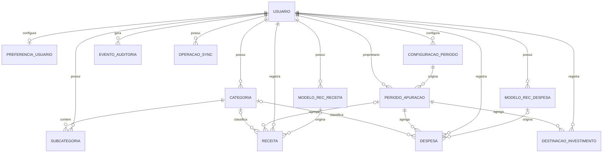

# Banco de Dados — Porquinho

**Versão:** 0.5  
**Data da última atualização:** 09/11/2026
**Status:** Modelo conceitual v0.5 e schema físico-base aprovados; migration PostgreSQL e RPC de categorias testadas localmente. RPCs das demais entidades, migration Drift e integração Supabase ainda pendentes.

## 1. Visão geral

Este documento registra o modelo conceitual aprovado e o schema físico-base aprovado em 09/11/2026. As migrations PostgreSQL estão em `supabase/migrations/`; RPCs das demais entidades e validação no Supabase gerenciado permanecem identificadas como pendentes. O schema não autoriza entidades fora do escopo aprovado.

O MVP armazena usuários, preferências de período, períodos de apuração, categorias, receitas, despesas, recorrências, destinações simples para investimentos, auditoria e operações de sincronização.

Não haverá entidades para contas bancárias, saldos individuais, saldo inicial especial, Porquinho virtual, reservas, compras/parcelas de cartão, carteira de ativos ou cálculo automático de rendimentos.

## 2. Tecnologia

| Tecnologia | Avaliação | Status |
|---|---|---|
| PostgreSQL | Banco remoto relacional | APROVADO |
| Supabase | Backend gerenciado e autenticação | APROVADO |
| SQLite com Drift | Persistência local offline | APROVADO |

O detalhamento de custo, segurança, isolamento por usuário, portabilidade, manutenção e integração por plataforma continua necessário, mas não reabre a escolha da stack aprovada.

## 3. Princípios de modelagem

- Identificar o usuário proprietário dos dados.
- Preservar histórico de edição e cancelamento.
- Não apagar fisicamente lançamentos financeiros cancelados.
- Representar a data de competência separadamente da data de pagamento quando tiverem significados diferentes.
- Usar valores monetários exatos, sem ponto flutuante binário.
- Manter recorrência-modelo separada de suas ocorrências geradas.
- Garantir idempotência na sincronização.
- Não criar entidades ou campos para funcionalidades fora do MVP.
- O único resultado financeiro calculado é a sobra do período.

## 4. Entidades conceituais

As entidades abaixo são conceitos aprovados para o modelo lógico; não são tabelas aprovadas e não autorizam esquema físico ou migrations.

| Entidade candidata | Finalidade | Status |
|---|---|---|
| Usuário | Identidade e proprietário dos dados | APROVADO (conceito) |
| Preferência do usuário | Tema, modalidade de período e configurações pessoais | APROVADO (conceito) |
| Configuração de período | Regra de mês-calendário ou ciclo personalizado, com vigência | APROVADO (conceito) |
| Período de apuração | Intervalo com início, fim e configuração; sem estado de encerramento manual | APROVADO (conceito) |
| Categoria | Categoria opcional de Receita ou Despesa criada pelo usuário | APROVADO (conceito) |
| Subcategoria | Classificação opcional subordinada à categoria | APROVADO (conceito) |
| Modelo de recorrência de receita | Configuração para gerar ocorrências de receita | APROVADO (conceito) |
| Ocorrência/receita | Receita avulsa ou ocorrência recorrente, com valor, recebimento e status | APROVADO (conceito) |
| Modelo de recorrência de despesa | Configuração para gerar ocorrências de despesa | APROVADO (conceito) |
| Ocorrência/despesa | Despesa avulsa ou ocorrência recorrente, com vencimento, valor e status | APROVADO (conceito) |
| Destinação para investimento | Lançamento simples de valor total destinado, sem ativo ou categoria | APROVADO (conceito) |
| Evento de auditoria | Histórico de criação, edição e cancelamento | APROVADO (conceito) |
| Operação de sincronização | Fila local, idempotência e estado de sincronização | APROVADO (conceito) |

O pagamento de despesa pode ser representado por campos de status e data na ocorrência/despesa, sem entidade separada, caso o modelo físico confirme que pagamentos parciais não fazem parte do MVP.

## 5. Dicionário conceitual

### 5.1 Usuário

Proprietário de lançamentos, categorias, recorrências, preferências e períodos. Campos conceituais: identificador, provedor de autenticação, e-mail, status e datas de criação/atualização.

### 5.2 Preferência e configuração de período

A preferência indica modalidade selecionada (mês-calendário ou ciclo personalizado). A configuração pode incluir dia inicial e data de início de vigência. Alterações só passam a valer no próximo período; períodos históricos preservam a configuração utilizada.

### 5.3 Período de apuração

Representa início inclusivo e fim exclusivo de um ciclo. Deve ter referência à configuração que o criou e associação aos lançamentos conforme suas datas de competência. Não possui estado operacional aberto/encerrado, pois não existe fechamento manual no MVP.

O período não possui saldo inicial bancário nem fotografia de contas. Usa intervalo [início, fim); ciclos personalizados preservam o dia original e usam o último dia disponível em meses curtos.

### 5.4 Categoria e subcategoria

Categoria pertence a um usuário e possui tipo imutável: Receita ou Despesa. Inclui nome, status ativo/inativo e datas. A associação de categoria a receitas e despesas é opcional. Subcategoria também é opcional. Categorias utilizadas devem ser desativadas, não apagadas, para preservar o histórico.

Destinações para investimento não usam categorias.

### 5.5 Modelo de recorrência

Modelos de recorrência de receita e de despesa são entidades conceituais separadas. Campos conceituais: usuário, descrição, tipo, frequência (mensal ou por período), data de início, valor padrão quando fixo, indicador fixo/variável, categoria quando aplicável, vencimento quando aplicável e status ativo/inativo.

O tratamento funcional de datas inexistentes está aprovado: usar o último dia do mês, preservando a referência original para meses seguintes. `America/Sao_Paulo` por usuário foi aprovado em 08/11/2026; horário e calendário operacional da geração permanecem detalhamento técnico.

### 5.6 Receita

Representa receita avulsa efetivamente recebida ou ocorrência de receita recorrente. Campos conceituais: usuário, descrição, categoria opcional, valor, data efetiva de recebimento, referência opcional ao modelo/ocorrência, status (pendente/recebida/cancelada), período de apuração e metadados de auditoria. Uma ocorrência recorrente ainda pendente não possui data efetiva de recebimento nem competência financeira; associá-la a um período para cálculo somente após a confirmação do recebimento. Receita avulsa e receita recorrente recebida devem pertencer a um período.

Receita recorrente é gerada pendente e só compõe a sobra após confirmação do recebimento. O valor da ocorrência pode ser editado sem alterar o modelo nem futuras ocorrências.

### 5.7 Despesa

Representa despesa avulsa ou ocorrência de recorrência. Campos conceituais: usuário, descrição, categoria opcional, valor, data de cadastro/geração (competência), vencimento opcional, data efetiva do pagamento, status (pendente/paga/cancelada), referência opcional ao modelo e período de apuração. Toda despesa pertence a um período.

Despesa avulsa entra na sobra no cadastro. Despesa recorrente entra ao ser gerada e ter valor definido. Pagamento não gera dedução adicional. Despesa pendente não é transportada financeiramente para o período seguinte; permanece no histórico do período de origem.

### 5.8 Fatura de cartão

Não existe entidade Cartão ou Fatura. A fatura é representada por uma despesa recorrente variável comum, com descrição livre. Não modelar compras, parcelas, fechamento ou limite.

### 5.9 Destinação para investimento

Lançamento simples com usuário, valor, data e período de apuração. Não possui descrição obrigatória, categoria de ativo, instituição, quantidade, posição, rentabilidade ou status de pagamento. O valor é deduzido da sobra assim que registrado. O Dashboard apresenta um único total de valores destinados a investimentos no período.

### 5.10 Evento de auditoria

Registra entidade afetada, identificador do registro, usuário, operação (criação, edição, cancelamento ou mudança de status), valores anteriores e novos quando aplicável, data/hora e justificativa opcional. A referência à entidade afetada pode ser polimórfica, desde que validada de forma segura.

### 5.11 Operação de sincronização

Registra identificador idempotente, usuário, instalação/dispositivo, tipo de operação, referência local, estado, tentativas, datas e erro recuperável. O desenho final depende da tecnologia local/remota aprovada.

## 6. Relacionamentos conceituais

- Um usuário possui várias categorias, subcategorias, recorrências, receitas, despesas, destinações para investimento, períodos e eventos de auditoria.
- Uma configuração de período pode originar vários períodos de apuração ao longo do tempo.
- Cada período de apuração referencia a configuração usada na sua criação.
- Um período reúne receitas, despesas e destinações para investimento de acordo com as datas de competência.
- Uma categoria de Receita pode classificar várias receitas; uma categoria de Despesa pode classificar várias despesas.
- Uma categoria pode ter várias subcategorias; cada subcategoria pertence a uma categoria.
- Um modelo de recorrência pode gerar várias ocorrências do tipo correspondente.
- Uma receita pode ser avulsa ou originada de um modelo de recorrência.
- Uma despesa pode ser avulsa ou originada de um modelo de recorrência.
- Uma despesa pode registrar status e data de pagamento; pagamentos parciais não fazem parte do MVP.
- Uma destinação para investimento pertence a um usuário e a um período, sem referência a ativo ou classe de investimento.
- Eventos de auditoria identificam usuário e registro afetado.
- Operações de sincronização pertencem ao usuário e referenciam uma operação financeira ou de configuração.

## 7. Diagrama entidade-relacionamento conceitual

O diagrama AUD-05 revisado e vigente está na seção 15.5. Ele substitui versões anteriores e deve ser lido em conjunto com o catálogo de entidades; não autoriza esquema físico ou migrations.

## 8. Cálculo e representação monetária

- Todos os valores do MVP são BRL, representados em centavos como inteiros assinados de 64 bits.
- Zero é permitido; valores negativos e entradas com mais de duas casas decimais são rejeitados. Não há arredondamento implícito.
- Não usar float/double binário para persistência ou cálculo monetário.
- Centralizar a fórmula da sobra no domínio.
- Sobra do período = receitas contabilizadas - despesas contabilizadas - destinações para investimentos.
- Não há saldo inicial especial, saldo bancário, dinheiro livre ou saldo disponível.

A seção 16.8 propõe `BIGINT` assinado de 64 bits por valor individual no PostgreSQL; essa faixa técnica depende da aprovação do esquema físico e não constitui limite de produto aprovado. Nenhum limite de produto foi definido.

## 9. Integridade e consistência

- Cada registro financeiro pertence a um usuário.
- Categorias devem pertencer ao mesmo usuário dos lançamentos associados.
- Categoria tem tipo imutável (Receita/Despesa).
- Lançamentos cancelados não participam dos cálculos, mas permanecem armazenados.
- Edição ou cancelamento recalcula os períodos afetados.
- Alteração da data de competência pode mover o lançamento para outro período.
- Confirmação de pagamento de despesa não deve duplicar dedução.
- Confirmação de recebimento de receita recorrente contabiliza o valor uma única vez.
- Sincronização repetida não aplica novamente a mesma operação.

## 10. Segurança e isolamento

A autorização deve garantir que cada usuário acesse apenas seus próprios lançamentos, categorias, recorrências, períodos e eventos. Segredos não devem ser persistidos no repositório. Como PostgreSQL/Supabase estão aprovados, definir e testar RLS e restrições referenciais antes da implementação remota.

## 11. Histórico e auditoria

Toda edição, cancelamento ou mudança de status relevante deve gerar evento de auditoria com usuário, registro afetado, instante e dados anteriores/novos quando aplicável. Lançamentos cancelados não devem ser apagados fisicamente.

## 12. Índices e desempenho

Índices, chaves e tipos SQL só serão definidos após escolha do banco e validação do modelo lógico. Consultas esperadas incluem lançamentos por usuário/período, receitas e despesas por categoria, ocorrências de recorrência e fila de sincronização.

## 13. Migrations e evolução

Backend, banco, modelo lógico conceitual e política funcional de sincronização estão aprovados. Criar tabelas físicas ou migrations somente após concluir o esquema físico, constraints, RLS e detalhes técnicos de sincronização. Mudanças futuras devem ser versionadas, revisáveis e acompanhadas de estratégia de evolução/reversão quando aplicável.

## 14. Pendências de modelagem

1. Definir esquema físico, tipos, índices e constraints após validar o modelo lógico.
2. Detalhar horário e calendário operacional da geração; a zona `America/Sao_Paulo` por usuário está aprovada.
3. Especificar fila offline, versionamento e persistência das versões conflitantes.
4. Detalhar retenção, restauração, exclusão definitiva e exportação.
5. Validar tecnicamente a integridade das referências polimórficas de auditoria e sincronização.

## 15. Baseline conceitual v0.5 — decisões e ajustes

**Data:** 08/11/2026. Esta seção prevalece sobre trechos anteriores que indiquem como pendentes decisões aqui aprovadas. O esquema físico continua sujeito a detalhamento; esta baseline não autoriza migrations.

### 15.1 Períodos

- Períodos usam `[data_inicio, data_fim)`: início inclusivo e fim exclusivo.
- Não armazenar estado operacional aberto/encerrado: o MVP não possui fechamento manual. Se houver estado técnico de sincronização ou processamento, nomear e documentar separadamente, sem confundir com encerramento do período.
- Períodos históricos mantêm a configuração de período que os originou. Alterações de configuração passam a valer no próximo período.
- Ciclo personalizado preserva o dia inicial original. Em mês curto, usa o último dia disponível; retorna ao dia original no mês seguinte quando possível. Exemplo dia 31: `[31/01,28/02)`, `[28/02,31/03)`, `[31/03,30/04)`.

### 15.2 Modelos e ocorrências recorrentes

Manter entidades/modelos separados para recorrência de receita e recorrência de despesa. Ambos pertencem diretamente a um usuário. Cada ocorrência pertence ao usuário e referencia seu modelo de origem.

Campos conceituais adicionais para modelos: identificador do usuário proprietário, frequência, data de início/vigência, dia de referência (quando mensal), estado ativo/inativo e parâmetros necessários à geração. Para ocorrência: modelo de origem, referência programada/competência, data efetiva, estado, valor e metadados de auditoria.

A combinação modelo + referência programada deve ser única, inclusive por restrição no banco, para garantir idempotência. Ocorrências atrasadas podem ser recuperadas na abertura do app e na sincronização. Edição individual não modifica modelo ou outras ocorrências; desativação preserva ocorrências existentes e impede futuras. A zona `America/Sao_Paulo` por usuário está aprovada; horário e calendário operacional ainda exigem especificação técnica.

A semântica canônica da referência usada na chave de unicidade deve ser definida no esquema físico, preservando a regra funcional aprovada de uma ocorrência por modelo e referência programada/competência.

### 15.3 Categorias, pagamentos e alertas

Categorias e subcategorias pertencem ao usuário proprietário. Categorias não são excluídas fisicamente; status ativo/inativo controla sua disponibilidade em novos lançamentos. Históricos mantêm referência à categoria original. Renomeação não reescreve lançamentos históricos.

Despesa possui pagamento integral, sem entidade de pagamento parcial nem saldo restante no MVP. Status e data efetiva do pagamento não geram nova dedução. Alertas permanecem ativos após o término do período enquanto a despesa estiver pendente e cessam ao pagar ou cancelar.

### 15.4 Auditoria e sincronização

Toda entidade de domínio deve ter proprietário identificável por usuário, inclusive modelos recorrentes, subcategorias, configurações/períodos e operações sincronizáveis. Eventos de auditoria registram usuário, entidade/registro afetado, operação, instante e valores anteriores/novos quando aplicável.

Operações de sincronização pertencem a um usuário e devem referenciar origem/registro local, identificador idempotente, versão esperada, estado, tentativas e resultado. Registros sincronizáveis possuem versão. Conflitos preservam as versões concorrentes e a resolução gera nova versão consolidada; não aplicar sobrescrita silenciosa.

### 15.5 Diagrama conceitual revisado — AUD-05

A relação de `EVENTO_AUDITORIA` com a entidade afetada é polimórfica e deve ser validada pela aplicação ou por mecanismo de integridade equivalente. `OPERACAO_SYNC` referencia a origem/registro por identificador tipado; essa relação polimórfica é intencionalmente omitida do Mermaid e sua integridade deve ser verificada no processo de sincronização. Todas as relações entre entidades de usuário devem impedir referência cruzada entre proprietários. Cada usuário pode ter zero ou uma preferência; cada preferência pertence a exatamente um usuário.

As relações de categoria para receita/despesa são opcionais por decisão aprovada: todo lançamento pode ter zero ou uma categoria compatível, pertencente ao mesmo usuário. Cada receita e despesa é avulsa ou originada de um modelo recorrente; lançamentos avulsos não referenciam modelo, e ocorrências recorrentes referenciam exatamente um modelo do tipo correspondente. A associação da receita ao período é opcional apenas enquanto uma receita recorrente está pendente; receitas avulsas, receitas recorrentes recebidas, despesas e destinações de investimento pertencem a exatamente um período. Relatórios por categoria agrupam lançamentos sem classificação em **Sem categoria**, sem removê-los dos totais gerais.

### 15.6 Backup, exclusão e exportação

O modelo deve suportar exportação CSV dos dados financeiros do usuário e exclusão definitiva. Backup remoto diário com retenção de 30 dias e restauração controlada. Definir tombstones ou mecanismo equivalente para que registros excluídos não reapareçam após sincronização/restauração. A política de retenção legal/técnica e propagação de exclusões aos backups deve ser especificada na arquitetura.

### 15.7 Metas de consulta

Metas iniciais: Dashboard local até 1 s; lista até 1 s; salvamento local até 500 ms; cálculo da sobra até 300 ms; sincronização de lote pequeno até 5 s em conexão normal. Validar por medição antes de tratar como critério de aceite final.

## 16. Proposta de esquema físico inicial

**Status:** PROPOSTA — aguarda revisão e aprovação. Este desenho detalha o modelo conceitual v0.5; não autoriza migrations nem cria novas regras funcionais.

### 16.1 Convenções e propriedade

O Supabase Auth (`auth.users`) é a fonte da identidade; não se propõe duplicar a tabela de usuários. Entidades do aplicativo usam UUID gerado no cliente, `owner_id` UUID obrigatório, `version` inteira crescente e timestamps de criação/atualização. A chave lógica principal é `(owner_id, id)` para permitir referências compostas que impeçam relações entre proprietários diferentes.

Proposta de mapeamento:

| Conceito | Tabela candidata | Campos físicos principais |
|---|---|---|
| Preferência | `user_preferences` | `owner_id` (único), tema opcional e `time_zone_id` IANA com padrão `America/Sao_Paulo` |
| Configuração de período | `period_configurations` | `id`, `owner_id`, modalidade, dia inicial quando aplicável, início de vigência |
| Período | `accounting_periods` | `id`, `owner_id`, configuração de origem, `start_date`, `end_date` |
| Categoria | `categories` | `id`, `owner_id`, tipo imutável, nome, ativo/inativo |
| Subcategoria | `subcategories` | `id`, `owner_id`, `category_id`, nome, ativo/inativo |
| Modelo de receita recorrente | `income_recurrence_templates` | proprietário, frequência, parâmetros de agenda, valor fixo/variável, categoria opcional, ativo/inativo |
| Modelo de despesa recorrente | `expense_recurrence_templates` | proprietário, frequência, parâmetros de agenda, valor fixo/variável, categoria opcional, ativo/inativo |
| Receita | `income_entries` | proprietário, descrição, centavos, recebimento, status, categoria/período opcionais enquanto pendente, modelo e referência programada opcionais |
| Despesa | `expense_entries` | proprietário, descrição, centavos, competência, vencimento/pagamento, status, categoria opcional, período e modelo opcionais conforme origem |
| Destinação para investimento | `investment_allocations` | proprietário, centavos, data do lançamento e período; sem categoria ou status de pagamento |
| Auditoria | `audit_events` | proprietário, entidade/tipo, operação, instante, snapshots anteriores/novos |
| Idempotência remota | `applied_sync_operations` | proprietário, chave idempotente, resultado e instante de aplicação |
| Conflito remoto | `sync_conflicts` | proprietário, entidade, versão-base, snapshots concorrentes, estado e resolução |
| Fila local | `sync_outbox` | chave idempotente, entidade, versão esperada, payload, tentativas, estado e próximo retry |

`sync_outbox` é local. As tabelas remotas de operações aplicadas e conflitos apoiam idempotência e resolução; não substituem os registros de domínio. Campos opcionais e suas combinações devem ser fechados contra o fluxo funcional de cada entidade antes da migration.

### 16.2 Tipos e constraints propostas

No PostgreSQL, propõem-se `uuid`, `date`, `timestamptz`, `bigint`, `boolean` e `text` com `CHECK` para valores enumerados. No SQLite/Drift, IDs, enums e centavos são `TEXT` canônico; o mapeamento Dart converte centavos para `BigInt`. Isso evita perda de precisão no Flutter Web, cujo `int` JavaScript não representa todos os inteiros de 64 bits. Datas são ISO `YYYY-MM-DD` e instantes ISO UTC; datas não são convertidas por timezone.

Valores são BRL em centavos. Armazenar `amount_centavos` em `BIGINT` no PostgreSQL e como texto decimal canônico no SQLite/Drift; o domínio Dart usa `BigInt`, e o protocolo de sincronização transmite centavos como string decimal. Não converter valores monetários para `double` nem para `int` no Flutter Web. Zero é permitido; negativos e entradas com mais de duas casas decimais são rejeitados, sem arredondamento. O limite superior técnico por lançamento é o máximo do inteiro assinado de 64 bits; não há limite de produto menor aprovado. Agregações locais usam `BigInt`; as remotas usam `NUMERIC` para soma exata sem overflow intermediário.

Constraints propostas:

- `start_date < end_date` para períodos, com intervalos semiabertos;
- unicidade do período por proprietário e início, além de prevenção de sobreposição;
- chaves estrangeiras compostas por proprietário para categoria, subcategoria, período e modelo de recorrência;
- unicidade de ocorrência recorrente por proprietário, modelo e referência programada, aplicável somente às ocorrências com modelo;
- unicidade da chave idempotente por proprietário;
- ausência de `period_id` em receita recorrente ainda pendente e associação a período após recebimento;
- categoria opcional, sempre compatível com o tipo e proprietário do lançamento;
- investimento sem categoria, sem pagamento e sem descrição obrigatória.

O mecanismo físico de prevenção de sobreposição de períodos (por exemplo, constraint de exclusão ou validação transacional equivalente) depende da validação de extensões disponíveis no PostgreSQL gerenciado. A data de competência e o período associado também precisam ser validados na mesma transação; uma `CHECK` simples não valida outra linha/tabela.

### Índices candidatos

Além das chaves e índices únicos das constraints, propõem-se índices iniciados por `owner_id` para refletir as consultas aprovadas: lançamentos por período/data; receitas e despesas por período/categoria; períodos por início; eventos de auditoria por entidade e instante; e modelos/ocorrências por referência programada. A fila local pode indexar estado e próximo retry. O plano de consulta deve validar esses candidatos com dados representativos antes de fixá-los; índices redundantes às constraints não devem ser criados.

### 16.3 RLS e autorização

RLS será habilitada em todas as tabelas remotas que contenham dados de usuário. A política-base exige `auth.uid() = owner_id` em leitura e escrita, além de validação da identidade nas funções de sincronização. Tabelas filhas precisam validar o mesmo proprietário por referência composta. Acesso anônimo é negado. A proposta é não conceder escrita direta às tabelas financeiras: operações passam por funções autenticadas e transacionais que validam regras, versão esperada, auditoria e idempotência.

O conjunto de testes deve criar dois usuários e demonstrar que cada um lê e altera apenas suas linhas; referências a categoria, período ou recorrência de outro usuário falham; usuário anônimo não acessa dados; e repetir uma operação idempotente não duplica alteração nem auditoria.

### 16.4 Auditoria e sincronização

`audit_events` é append-only para o fluxo normal. Como a referência ao registro afetado é polimórfica, a proposta exige que a função transacional valide tipo, ID e proprietário antes de gravar os snapshots. Valores sensíveis não necessários não devem ser incluídos nos snapshots.

Cada linha sincronizável tem versão. A aplicação remota compara a versão esperada, registra a nova versão e o evento de auditoria atomicamente, ou preserva os snapshots concorrentes em `sync_conflicts`. `applied_sync_operations` possui chave única por proprietário e operação, guardando resposta suficiente para reenvio idempotente. Resolução de conflito cria uma nova versão; não atualiza silenciosamente um estado concorrente.

### 16.5 Migrations e evolução

Migrations PostgreSQL seriam mantidas em `supabase/migrations/`, ordenadas e revisáveis. A aplicação local de teste deve começar de banco vazio, aplicar toda a sequência e executar testes de constraints/RLS. Produção recebe migrations já aplicadas e verificadas em ambiente de teste, com estratégia documentada de evolução e recuperação.

Drift mantém `schemaVersion`, snapshots gerados e migrações locais independentes. Cada migração local deve ser testada da versão anterior para a nova, preservando dados. O contrato lógico e casos de paridade são comuns aos dois armazenamentos; tipos e scripts de migration não precisam ser idênticos.

### 16.6 Pendências antes da aprovação do esquema

**Registro histórico da Entrega 1:** o texto abaixo registra as pendências existentes antes da validação do schema na Entrega 2. O estado atual e as pendências remanescentes estão nas seções 16.8 e 16.9.

1. Aprovar campos e nullability de receita/despesa recorrente pendente, especialmente valor variável e período.
2. Aprovar a representação canônica da referência mensal e por período e a respectiva constraint.
3. Validar mecanismo de não sobreposição e continuidade de períodos no PostgreSQL de destino.
4. Aprovar tipos, índices, política de exclusão definitiva/tombstones e retenção de auditoria.
5. Testar compatibilidade de criptografia e armazenamento local em Android, iOS e Web antes da implementação correspondente.

Naquele momento, até a resolução dessas pendências e aprovação explícita do esquema físico, o documento permanecia PROPOSTA e nenhuma migration definitiva deveria ser criada.

### 16.7 Resultado da revisão da Entrega 1 — classificação para validação

Esta tabela registra o estado ao final da Entrega 1. Moeda/escala e zona IANA foram decididas pelo responsável na Entrega 2; ver a seção 16.8.

| Tema | Status | Registro |
|---|---|---|
| Modelo conceitual v0.5 | APROVADO | Permanece a fonte do escopo das entidades; não se criam entidades fora do MVP. |
| Esquema físico da seção 16 | PROPOSTA | A aprovação do planejamento da Fase 2 não substitui a aprovação explícita do esquema. |
| Inteiros de 64 bits em unidade mínima | PROPOSTA | Estratégia recomendada; moeda, escala, limites e rejeição de casas excedentes precisam de decisão. |
| Propriedade, chaves compostas e RLS | PROPOSTA | Princípio de isolamento aprovado; constraints e políticas concretas aguardam validação e testes. |
| Unicidade de recorrências e associação a períodos | PENDENTE | Referência mensal versus identificador do período e nullability precisam ser fechadas antes da migration. |
| Não sobreposição e continuidade dos períodos | PENDENTE | Validar constraint disponível ou mecanismo transacional equivalente no PostgreSQL de destino. |
| Auditoria, idempotência e conflitos | APROVADO como requisitos; desenho físico PROPOSTA | As entidades e constraints finais continuam sujeitas à aprovação do esquema. |
| Migrations PostgreSQL e Drift | APROVADO como estratégia; execução PENDENTE | Não foram criadas migrations nesta entrega. |

Os valores e registros usados nos futuros testes de banco serão fixtures sintéticas, isoladas dos ambientes com dados reais.

### 16.8 Esquema físico detalhado — Entrega 2

**Data:** 09/11/2026. **Status:** APROVADO pelo responsável em 09/11/2026 como base do schema. A migração PostgreSQL inicial e seus testes constam na seção 16.9. As RPCs das demais entidades, a migration Drift e a validação no Supabase gerenciado permanecem pendentes.

#### 16.8.1 Convenções comuns

- Identificadores de domínio são UUIDs criados no cliente para permitir gravação offline. Tabelas remotas de domínio usam `owner_id UUID NOT NULL` e chave primária composta `(owner_id, id)`; `user_preferences` usa `owner_id` como chave primária.
- `owner_id` referencia `auth.users(id)` com `ON DELETE RESTRICT`; referências entre dados de usuário usam chaves estrangeiras compostas que incluem `owner_id`, impedindo associações entre proprietários diferentes. Exclusão definitiva da conta requer fluxo transacional explícito, após exportação e sincronização, que remova os dados dependentes na ordem segura.
- Registros mutáveis e sincronizáveis mantêm `version BIGINT`, `created_at TIMESTAMPTZ` e `updated_at TIMESTAMPTZ`. Eventos e resultados imutáveis têm instante próprio. No SQLite, IDs, enums e centavos são `TEXT`; datas são `TEXT` ISO `YYYY-MM-DD`, instantes são texto UTC ISO-8601 e versões usam `INTEGER`.
- Todos os valores monetários usam BRL em centavos, sem coluna `currency_code` no MVP. O limite superior técnico é `9.223.372.036.854.775.807` centavos por valor; nenhum limite de produto menor está aprovado.
- `user_preferences.time_zone_id` guarda a zona IANA por usuário, com padrão `America/Sao_Paulo`. A zona determina a data corrente usada para recuperar ocorrências vencidas ao abrir o aplicativo ou sincronizar. Política para uma futura alteração da zona permanece pendente; períodos e datas já persistidos não são instantes e não são convertidos.

#### 16.8.2 Tabelas e campos do schema aprovado

| Tabela | Campos e regras aprovados; situação de implementação |
|---|---|
| `user_preferences` | `owner_id` PK/FK; `theme` opcional (`light`/`dark`); `time_zone_id` obrigatório com padrão aprovado; `version`, `updated_at`. Uma linha por usuário. |
| `period_configurations` | `id`, `owner_id`, `mode` (`calendar_month`/`custom_cycle`), `custom_start_day` (1–31 somente no ciclo personalizado), `effective_from DATE`, versão e timestamps. Configurações antigas não são reescritas. |
| `accounting_periods` | `id`, `owner_id`, `configuration_id`, `start_date DATE`, `end_date DATE`, versão e timestamps. Sem estado aberto/encerrado. Período representa `[start_date, end_date)`. |
| `categories` | `id`, `owner_id`, `kind` (`income`/`expense`), `name`, `is_active`, versão e timestamps. `kind` é imutável; desativar em vez de excluir. |
| `subcategories` | `id`, `owner_id`, `category_id`, `name`, `is_active`, versão e timestamps. FK composta para categoria do mesmo proprietário e chave candidata `(owner_id, category_id, id)` para referências coerentes nos lançamentos. |
| `income_recurrence_templates` | `id`, `owner_id`, `description`, `frequency`, `starts_on DATE`, `monthly_reference_day` (1–31 em recorrência mensal; nulo por período), `value_mode` (`fixed`/`variable`), `default_amount_centavos` (obrigatório quando fixo; nulo quando variável), categoria e subcategoria opcionais compatíveis, ativo/inativo, versão e timestamps. |
| `expense_recurrence_templates` | Mesma estrutura de agenda e valor do modelo de receita, com categoria/subcategoria de despesa opcionais. Não armazena vencimento padrão: o vencimento é da ocorrência e não há regra aprovada para derivá-lo do modelo. |
| `income_entries` | `id`, `owner_id`, `description`, `amount_centavos` (pode ser nulo somente numa ocorrência variável sem valor), `status` (`pending`/`received`/`cancelled`), `received_on DATE` (nulo antes do recebimento), categoria/subcategoria opcionais, `accounting_period_id` nulo antes do recebimento, `recurrence_template_id`, `scheduled_for_date` e `scheduled_period_id` quando recorrente, versão e timestamps. |
| `expense_entries` | `id`, `owner_id`, `description`, `amount_centavos` (nulo somente enquanto uma ocorrência variável aguarda valor), `competence_on DATE`, `due_on DATE` opcional, `paid_on DATE` opcional, `status` (`pending`/`paid`/`cancelled`), categoria/subcategoria opcionais, `accounting_period_id` obrigatório, referência opcional ao modelo e agenda, versão e timestamps. |
| `investment_allocations` | `id`, `owner_id`, `amount_centavos` obrigatório, `allocated_on DATE`, `accounting_period_id`, `cancelled_at` opcional, versão e timestamps. Sem categoria, descrição ou status de pagamento. |
| `audit_events` | `id`, `owner_id`, `entity_type`, `entity_id`, `operation`, `actor_id`, `occurred_at`, snapshots anteriores/novos JSONB e `operation_id`. Append-only no fluxo normal. |
| `applied_sync_operations` | `owner_id`, `idempotency_key UUID`, hash do conteúdo recebido, resultado necessário para resposta idempotente e `applied_at`; chave única `(owner_id, idempotency_key)`. Reuso da chave com conteúdo diferente é rejeitado. |
| `sync_conflicts` | `id`, `owner_id`, entidade/registro, versão-base e versão remota, snapshots local/remoto, estado e dados da resolução. A resolução cria uma nova versão do registro. |
| `sync_outbox` (somente local) | `idempotency_key`, `owner_id`, entidade/registro, versão esperada, payload, estado, tentativas, próximo retry e último erro recuperável. Persiste na mesma transação local que o registro e a auditoria. |

#### 16.8.3 Nullability e constraints de integridade

- Valores gravados como centavos obedecem `amount_centavos >= 0`; zero é válido. Números negativos são recusados. O parser decimal de entrada aceita no máximo duas casas e rejeita precisão excedente, sem arredondar; conversão/armazenamento local e sincronização preservam centavos exatos como `BigInt`/string decimal.
- `amount_centavos IS NULL` distingue uma ocorrência recorrente variável ainda sem valor de uma ocorrência cujo valor é zero. Pode permanecer nulo se essa ocorrência for cancelada antes de informar o valor. Uma função transacional valida que somente uma ocorrência variável sem valor pode omitir o campo. Despesas/receitas avulsas, investimentos e recorrências fixas têm valor definido.
- Receitas usam os estados `pending`, `received` e `cancelled`. Em `received`, `received_on`, valor e período são obrigatórios; receita recorrente `pending` não tem data efetiva de recebimento nem período financeiro. Receita avulsa nasce `received`. Uma receita cancelada pode preservar os campos de recebimento anteriores, se foi cancelada após confirmação.
- Despesas usam `pending`, `paid` e `cancelled`. Toda despesa tem `competence_on` e período de origem; `paid` exige `paid_on`, enquanto `pending` não tem data de pagamento. Pagamento não altera competência nem período. Vencimento é opcional e fica na ocorrência. Cancelamento mantém o registro e gera auditoria; campos de pagamento anteriores podem ser preservados, e registros cancelados não participam dos cálculos.
- Todo investimento tem data e período. `cancelled_at` exclui a destinação dos cálculos sem introduzir status pendente/pago.
- Períodos exigem `start_date < end_date`, início único por usuário e configuração pertencente ao mesmo usuário. A criação ocorre por operação transacional que serializa a geração por usuário e confere a continuidade com os períodos vizinhos; não basta uma verificação de sobreposição. A regra de ciclo `[início, fim)` continua sendo a fonte funcional.
- Receita, despesa, categoria e subcategoria devem pertencer ao mesmo `owner_id`; o tipo da categoria deve ser compatível com o lançamento/modelo. Quando `subcategory_id` estiver informado, `category_id` também é obrigatório e a subcategoria deve pertencer àquela categoria. Chaves estrangeiras compostas podem impor proprietário e par categoria/subcategoria; a função transacional valida compatibilidade de tipo e exige categoria/subcategoria ativa somente para novas associações. Referências históricas podem continuar apontando para categorias desativadas.
- Em ocorrência recorrente, `scheduled_for_date` é a data efetivamente agendada; para frequência por período, é igual ao início do período e `scheduled_period_id` referencia esse período. Para mensal, `scheduled_period_id` é nulo e `scheduled_for_date` segue o dia original com ajuste de mês curto aprovado. Lançamentos avulsos não têm modelo nem referência programada.
- Índice único parcial candidato: `(owner_id, recurrence_template_id, scheduled_for_date)` para linhas recorrentes em cada tabela de ocorrência. A função valida a frequência do modelo e a consistência de `scheduled_period_id`; a unicidade evita repetição de modelo/data programada.
- Tipos de status/frequência são `TEXT` com `CHECK` para permitir evolução revisável. Nenhum lançamento financeiro é apagado fisicamente pelo fluxo normal.

Para impedir períodos sobrepostos, PostgreSQL oferece o tipo `daterange` com limites canônicos `[)` e constraints de exclusão. Como a constraint de exclusão sozinha não detecta lacunas e pode exigir a extensão `btree_gist` para combinar proprietário e intervalo, a proposta primária é criar períodos somente por função transacional, serializada por proprietário, que valida os limites adjacentes. Uma constraint de exclusão pode ser acrescentada como defesa extra se a extensão estiver disponível no serviço de destino. A implementação precisa cobrir ambas as condições: sem lacunas e sem sobreposições. O PostgreSQL disponibiliza advisory locks transacionais para serializar este recurso definido pela aplicação; seu uso exige que todas as gravações de períodos passem pela mesma função. [Documentação PostgreSQL sobre intervalos e exclusão](https://www.postgresql.org/docs/current/rangetypes.html) e [locks explícitos/advisory](https://www.postgresql.org/docs/18/explicit-locking.html).

#### 16.8.4 RLS, grants e funções

Na migração inicial da Entrega 3, RLS foi habilitada nas tabelas remotas. Políticas de leitura para `authenticated` exigem `auth.uid() IS NOT NULL AND auth.uid() = owner_id`; acesso `anon` é negado. Grants são separados: além de revogar `CREATE` público e todo DML direto dos clientes, a migration concede somente `SELECT` a `authenticated`. Essas políticas foram verificadas localmente com duas identidades Supabase simuladas; a integração no Supabase gerenciado ainda está pendente.

**Decisão de implementação da Entrega 4 para categorias:** `public.apply_category_change` usa `SECURITY DEFINER`, proprietário `postgres`, `search_path = ''`, nomes de objetos qualificados e execução concedida somente a `authenticated`. A função deriva o usuário de `auth.uid()` e restringe cada leitura/escrita ao mesmo `owner_id`; o cliente não fornece proprietário. Como o proprietário `postgres` ignora RLS, a verificação explícita de usuário dentro da função é obrigatória. O teste local cobre permissões, isolamento, versionamento, idempotência e auditoria. Este mecanismo está implementado somente para criar, renomear e desativar categorias; demais RPCs e a validação no Supabase gerenciado permanecem pendentes. A chave `service_role` permanece somente no servidor. [Guia Supabase de RLS](https://supabase.com/docs/guides/database/postgres/row-level-security) e [guia de funções](https://supabase.com/docs/guides/database/functions).

#### 16.8.5 Índices candidatos

- Índices candidatos para listas/totais por período: receita `(owner_id, accounting_period_id, received_on)`, despesa `(owner_id, accounting_period_id, competence_on)` e investimento `(owner_id, accounting_period_id, allocated_on)`.
- Índices por categoria: receita `(owner_id, category_id, received_on)` e despesa `(owner_id, category_id, competence_on)`; subcategoria pode ser incluída se as consultas dos relatórios justificarem.
- Índice parcial em `(owner_id, due_on)` para despesas `status = 'pending'` com vencimento, a validar com as consultas de alertas.
- Índice de auditoria por `(owner_id, entity_type, entity_id, occurred_at)`.
- Índice único parcial de recorrência descrito na seção 16.8.3.
- Índice local da fila por `(state, next_retry_at)`.

Índices criados pelas chaves primárias/únicas não serão duplicados. O plano final depende de testes de consultas com dados sintéticos representativos. PostgreSQL permite índices únicos parciais; a migração Drift deverá testar a mesma unicidade no SQLite da plataforma. [Documentação PostgreSQL de índices parciais](https://www.postgresql.org/docs/18/indexes-partial.html).

#### 16.8.6 Pendências técnicas após aprovação do schema

1. As FKs usam `ON DELETE RESTRICT`; implementar e testar futuramente o fluxo transacional de exclusão definitiva da conta, sem perder a proteção contra remoção física acidental de categorias ou histórico.
2. Não foi adicionada a extensão `btree_gist`. Toda gravação de períodos deve passar por RPC transacional que serialize por proprietário com advisory lock e valide continuidade e ausência de sobreposição; implementar e testar concorrência antes de liberar escrita.
3. A migration habilita leitura própria por RLS e bloqueia DML direto. A Entrega 4 implementa esse fluxo para categorias; criar e testar RPCs equivalentes para as demais entidades e validar todas no Supabase gerenciado.
4. Medir os índices com consultas representativas antes da otimização final.
5. Provar criptografia e compatibilidade Drift em Android, iOS e Web; a migration local ainda não foi criada.

A Entrega 2 foi validada pelo responsável em 09/11/2026. A migration da Entrega 3 foi aplicada somente a um PostgreSQL temporário local; não foi implantada em projeto Supabase ou produção.

#### 16.8.7 Testes automatizados de aceitação do modelo

Critérios de aceitação do schema; os itens ainda não executados estão marcados como pendentes:

1. Conversão exata de entrada BRL para centavos; zero aceito; valor negativo, mais de duas casas e overflow do inteiro de 64 bits rejeitados. Verificar parse, armazenamento local, sincronização e cálculo Web acima de `2^53 - 1` usando `BigInt`/texto decimal.
2. Cada período inclui a data inicial e exclui a final; criação concorrente não produz sobreposição nem lacuna. Casos de ciclos com dias 29, 30 e 31 e ano bissexto.
3. Unicidade por modelo e data programada; reenvio da mesma operação idempotente não cria segunda ocorrência ou auditoria.
4. Ocorrência variável com valor ausente distinguida de valor zero; receita pendente sem período financeiro; confirmação associa o período pela data efetiva de recebimento.
5. Despesa recorrente variável não entra no total enquanto não há valor; pagamento não produz segunda dedução; cancelamento preserva auditoria e exclui dos cálculos.
6. FKs compostas rejeitam referências cruzadas entre proprietários; associações incompatíveis ou subcategoria sem categoria são recusadas; RLS/RPC impedem leitura/escrita de outro usuário e acesso anônimo.
7. Repetição de chave idempotente retorna o resultado anterior; chave repetida com conteúdo diferente é recusada; versão esperada divergente preserva estados em conflito.
8. Migrations PostgreSQL partem de banco vazio; migrações Drift avançam da versão anterior sem perder dados; consultas locais e remotas produzem os mesmos resultados nos casos sintéticos.

**Executado na Entrega 3:** migration aplicada em banco PostgreSQL 18.6 vazio; constraints de sinal, período não vazio, modelo de recorrência, referência composta entre proprietários, chave única de ocorrência e tipo imutável de categoria; zero e ocorrência variável sem valor; leitura isolada entre dois usuários; acesso anônimo e escrita direta negados; valor acima de `2^53 - 1` preservado exatamente no PostgreSQL; remoção de usuário com dados bloqueada por `RESTRICT`. Fixtures são sintéticas.

**Executado na Entrega 4:** RPC de categorias testada para create/rename/deactivate, replay idempotente, reutilização de chave com payload diferente, controle de versão, conflito com snapshots, auditoria anterior/nova, ausência de sessão, isolamento entre usuários e grants de execução.

**Pendente:** parser/conversão BRL no Flutter, round-trip local Drift/Web, cálculos locais/remotos, criação contígua e concorrente de períodos, RPCs de escrita para as demais entidades, resolução de conflitos e testes de autorização no Supabase gerenciado.

#### 16.8.8 Referências técnicas

- [Dart: representação de números e precisão no Web](https://dart.dev/resources/language/number-representation)
- [Supabase: Row Level Security](https://supabase.com/docs/guides/database/postgres/row-level-security)
- [Supabase: Database Functions](https://supabase.com/docs/guides/database/functions)
- [PostgreSQL: Range Types](https://www.postgresql.org/docs/current/rangetypes.html)
- [PostgreSQL: Explicit Locking](https://www.postgresql.org/docs/18/explicit-locking.html)
- [PostgreSQL: Partial Indexes](https://www.postgresql.org/docs/18/indexes-partial.html)

### 16.9 Entrega 3 — migration PostgreSQL inicial

**Implementado na Entrega 3:** `supabase/migrations/20261109000100_initial_schema.sql` cria as tabelas remotas aprovadas, constraints, chaves compostas por proprietário, índices, triggers para tipo imutável de categoria e compatibilidade do tipo de categoria. Todas as FKs para `auth.users` e referências históricas usam `ON DELETE RESTRICT`; a limpeza definitiva de conta ficará em uma operação transacional explícita futura. O migration aplica RLS, concede somente leitura própria a `authenticated` e bloqueia DML direto. Naquele ponto, as RPCs de escrita ainda não existiam.

**Testes automatizados:** `tooling/test_postgres_schema.ps1` cria PostgreSQL 18.6 temporário em loopback, inicializa banco vazio, simula `auth.users`, roles `anon`/`authenticated` e `auth.uid()`, aplica todas as migrations e executa os arquivos `supabase/tests/*_test.sql`. Para repetir, deixe `initdb.exe`, `pg_ctl.exe` e `psql.exe` no `PATH` e rode `powershell.exe -NoProfile -ExecutionPolicy Bypass -File tooling/test_postgres_schema.ps1`. A suíte passou em 09/11/2026. A autenticação foi simulada; a suíte não substitui integração com Supabase gerenciado.

### 16.10 Entrega 4 — RPC transacional de categorias

`supabase/migrations/20261109000200_category_write_rpc.sql` cria `public.apply_category_change(operation_id, action, category_id, expected_version, kind, name)`. A RPC implementa somente `create`, `rename` e `deactivate`, ações previstas para categorias. O usuário é obtido por `auth.uid()`; não existe parâmetro de proprietário. Criação exige versão esperada zero; alteração exige versão positiva e, em caso de divergência, preserva os snapshots local/remoto em `sync_conflicts` e retorna o conflito sem sobrescrever a categoria.

Cada chamada grava a categoria ou conflito, o resultado idempotente e, quando aplicada, o evento de auditoria na mesma transação PostgreSQL. Repetir a mesma chave e conteúdo retorna a resposta registrada; a mesma chave com conteúdo diferente é rejeitada. A hash é apenas um filtro e a igualdade exata do JSONB da solicitação também é verificada. O tipo da categoria não pode ser alterado. A função é `SECURITY DEFINER`, pertence a `postgres`, usa `search_path` vazio, qualifica objetos e concede `EXECUTE` somente a `authenticated`; o acesso explícito por usuário continua obrigatório porque a função proprietária ignora RLS.

**Testado localmente:** sessão autenticada e ausente, grants, isolamento de proprietário, create/rename/deactivate, avanço da versão, auditoria, repetição idempotente, chave reutilizada com outro conteúdo, conflito persistido e repetido sem duplicação.

**Pendente:** teste no Supabase gerenciado, chamadas concorrentes, resolução do conflito como nova versão e RPCs de períodos, subcategorias, lançamentos e recorrências. O PostgreSQL local usado na suíte simula `auth.uid()` e não comprova configuração ou privilégios do projeto remoto.
